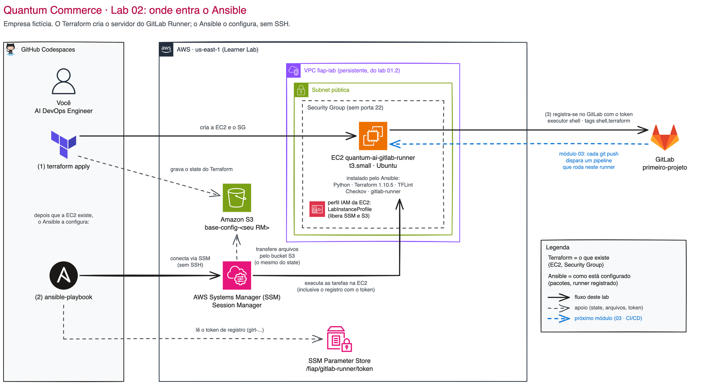

# 02 — Ansible: configuração de servidores como código

> **Aula 3 na Quantum Commerce.**
> Na Aula 2 (módulo 01), você, AI DevOps Engineer da **Quantum Commerce**, transformou em código a infraestrutura do **AI Customer Assistant** (o Assistente de Rastreio e Políticas): a rede `fiap-lab`, a EC2 com a página, o ALB com `count`, o state no S3 e os workspaces `dev`/`prod`. **Helena Marques**, Head de Engenharia de IA e Entrega Contínua, volta com a próxima dor:
>
> > *— "A infra virou código, ótimo. Mas os servidores ainda são configurados à mão, cada um de um jeito, e quem roda o `terraform apply` é o laptop de alguém. Antes de automatizar o deploy do assistente, quero uma máquina de build **nossa**, configurada sempre do mesmo jeito: subir uma nova tem que ser rodar um playbook, não seguir um documento de 30 passos."*

Este módulo é o **segundo passo** da Quantum Commerce para sair do "na mão" e chegar ao "tudo como código versionado". O Terraform (módulo 01) cria a máquina; o **Ansible** entra logo depois para **configurar** essa máquina de forma declarativa e repetível, transformando uma EC2 nua num **GitLab Runner** pronto para rodar o pipeline do assistente no módulo 03.

## O laboratório deste módulo

| # | Laboratório | O que você faz | Tempo estimado |
|---|-------------|----------------|----------------|
| **02.1** | **[Provisionando um GitLab Runner com Ansible](01-provisionando-gitlab-runner/README.md)** | Cria o projeto `primeiro-projeto` no GitLab, provisiona a EC2 do runner com Terraform e usa um playbook Ansible para instalar as ferramentas e registrar um GitLab Runner dedicado ao projeto. | 70-100 min |

O runner que você registra aqui é exatamente quem vai executar os pipelines de `terraform plan`/`apply` do **módulo 03 (CI/CD)**. Por isso ele fica de pé no fim deste módulo.

## Onde o Ansible entra

| Peça | Papel na Quantum Commerce | Em uma frase |
|------|---------------------------|--------------|
| **Terraform** | Cria a EC2 do runner e o Security Group | O **que existe** |
| **Ansible** | Instala Terraform, TFLint, Checkov e o `gitlab-runner` dentro da EC2 e registra o runner | **Como a máquina está** por dentro |
| **SSM (AWS Systems Manager)** | Canal entre o Codespaces e a EC2 | Sem SSH, sem chave e sem porta 22 |
| **GitLab** | Guarda o código e dispara os jobs | Cada `git push` aciona o runner |

**Idempotência** é o que torna isso confiável: rodar o mesmo playbook duas vezes dá o mesmo servidor. Na segunda execução o Ansible confere cada item, vê que já está certo e não muda nada. Para a Helena, isso significa que um runner novo (ou um runner reconstruído depois de um problema) fica idêntico ao anterior.

## Por que Ansible (e não mais um shell script)

| Aspecto | Resposta curta |
|---------|----------------|
| **Problema de negócio** | A Quantum Commerce vai precisar de runners para as três iniciativas de IA. Configurar cada um à mão é lento, propenso a erro e impossível de auditar. |
| **Onde Ansible brilha** | Descrever o **estado desejado** do servidor (pacotes, serviços, arquivos) e aplicar de forma idempotente: rodar de novo não quebra nada. |
| **Onde Ansible sofre** | Criar a infraestrutura em si (a VPC, a EC2). Isso continua sendo trabalho do Terraform. |
| **Quando acontece na vida real** | Toda vez que um time separa "criar a máquina" (Terraform) de "configurar a máquina" (Ansible), o padrão clássico de IaC + configuration management. |

## Pré-requisitos

Antes de começar o lab deste módulo:

- [ ] **Módulo 01 (Terraform) concluído**: você já rodou `terraform init/plan/apply` e entende state remoto no S3
- [ ] A VPC `fiap-lab` do [Lab 01.2](../01-Terraform/demos/02-Modules/README.md) existe (o runner nasce nela)
- [ ] Bucket de state remoto existe no S3 (`base-config-<SEU-RM>`, criado no [setup inicial](../00-create-codespaces/README.md))
- [ ] Credenciais AWS do Academy atualizadas no Codespaces: valide com `aws sts get-caller-identity`
- [ ] Uma conta no [GitLab](https://gitlab.com/) (gratuita)

## Custo do módulo

O lab cria **uma EC2 `t3.small`** com disco de 30 GB, que fica de pé porque os módulos 03 e 04 usam:

- **EC2 `t3.small`**: ~US$ 0,02/h (~US$ 0,50 por dia ligada, ~US$ 3,50 por semana)
- **Disco gp3 de 30 GB**: ~US$ 0,08 por dia
- **S3** (state remoto) e **SSM Parameter Store** (token): centavos ou zero

> [!CAUTION]
> **Não destrua o runner no fim deste módulo.** Os pipelines dos módulos 03 (CI/CD) e 04 (GenAIOps) dependem dele. Entre aulas, **desligue** a EC2 como mostra o **[passo 15 do Lab 03.2](../03-CICD/02-Validando-e-gerando-relatorios/README.md#passo-15)** (desligada, só o disco cobra, ~US$ 0,08/dia). O `terraform destroy` do runner é o **último passo da demo 04.2**, quando o ciclo de AWS da disciplina termina e o custo zera. O Trabalho Final sobe um runner próprio. A rede `fiap-lab` não é destruída em nenhum desses momentos.

## Próximo módulo

Após concluir o lab deste módulo, prossiga para:

**[03 — CI/CD com GitLab](../03-CICD/README.md)**: com o runner registrado, todo push na `master` do `primeiro-projeto` vai disparar `plan` e `apply` automáticos, com um gate de segurança que barra configuração insegura antes de chegar na nuvem.
