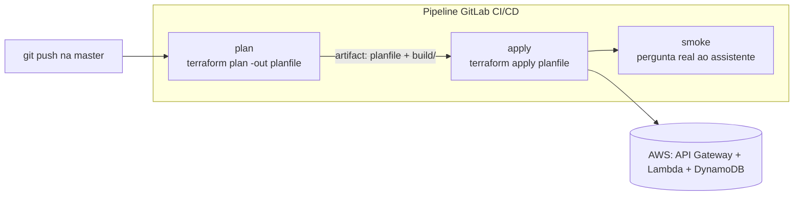
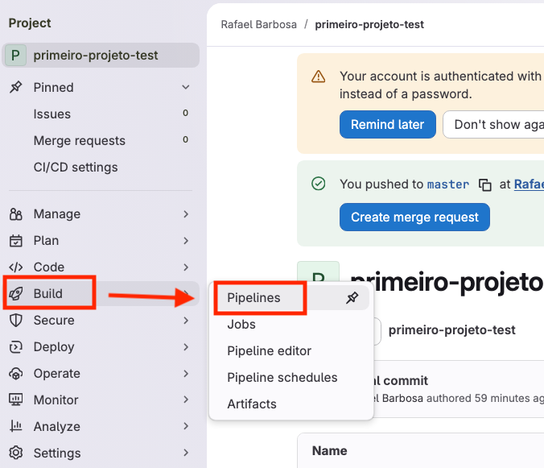
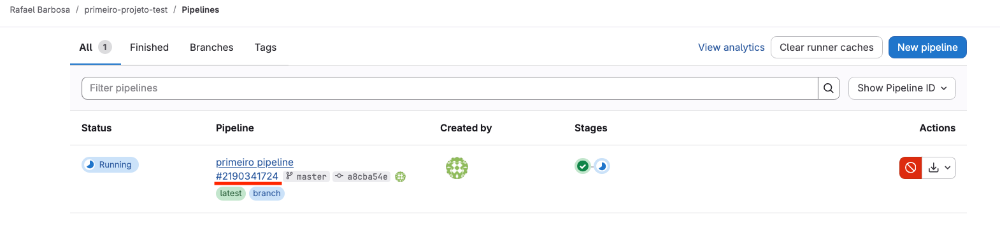
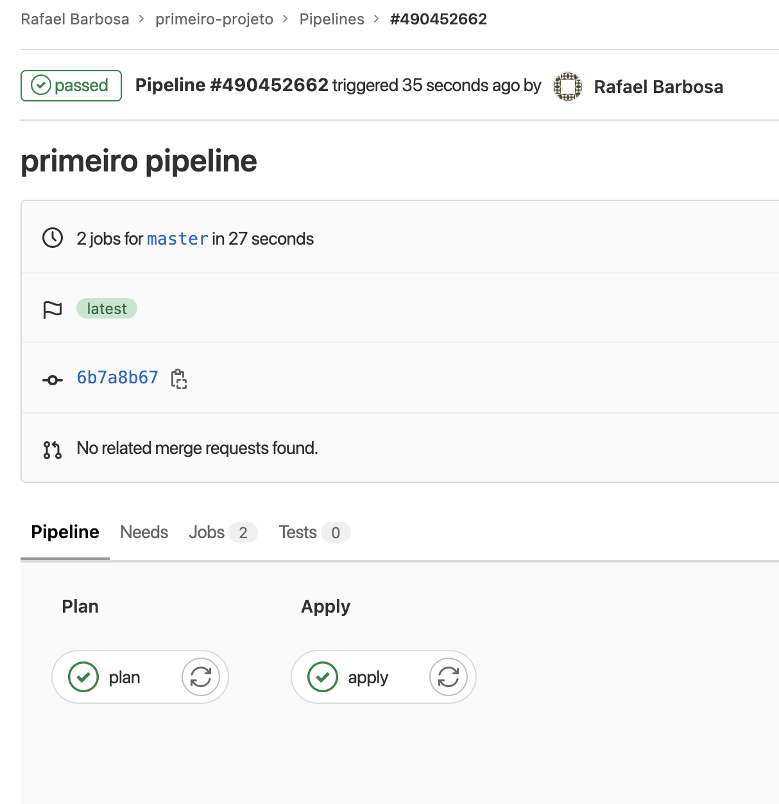
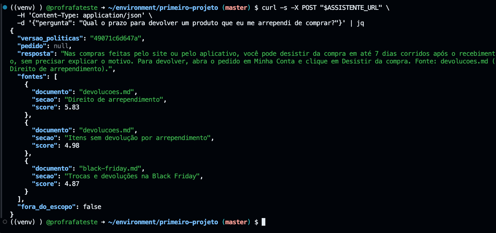
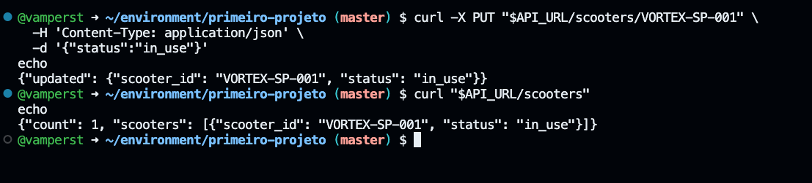

# 03.1 - Primeiro pipeline: publicando o Assistente de Políticas

<!--
CONVENÇÃO DE PRINTS DESTE README (nota para o professor, não aparece renderizada)
- TROCAR-IMAGEM: print antigo ainda visível; sobrescreva o arquivo com o mesmo nome e apague o comentário.
- NOVA-IMAGEM: print que ainda não existe; salve o PNG no caminho indicado e descomente a linha de imagem logo abaixo.
- CONFIRMAR-SAIDA: saída esperada a preencher com o resultado do teste real.
-->

> **Segunda-feira, 10h. Aula 4 na Quantum Commerce.**
> Você é AI DevOps Engineer na **Quantum Commerce**. O runner que você provisionou com Ansible está online desde a semana passada. **Helena Marques**, Head de Engenharia de IA e Entrega Contínua, chega com uma reclamação do Procon impressa: um cliente ouviu do atendimento que tinha 30 dias para devolver um fone, quando a política diz 7.
>
> > *— "Quero o Assistente de Políticas no ar, respondendo só o que está escrito na política e dizendo de qual política tirou a resposta. Se o jurídico perguntar de onde veio uma resposta, a gente mostra o documento."*
>
> **Diego Tavares**, AI SRE sênior, completa: *— "E ninguém publica isso do laptop. Todo push na `master` roda `plan`, depois `apply`, e no fim faz uma pergunta de verdade ao assistente publicado. Se a pergunta não voltar com fonte, o pipeline fica vermelho."*

Os comandos de terminal deste lab rodam no **terminal do Codespaces** da disciplina. A leitura dos pipelines acontece no **GitLab** (gitlab.com), no navegador. Cada passo diz onde executar.

> [!WARNING]
> **Pré-requisitos obrigatórios antes de começar:**
>
> - [ ] **Módulo 02 concluído**: GitLab Runner **online** com as tags `shell` e `terraform`, e o repositório `primeiro-projeto` no seu GitLab.
> - [ ] **Cópia local do projeto** em `/home/vscode/environment/primeiro-projeto` (passo 9 do módulo 02).
> - [ ] **Chave SSH do GitLab** em `/home/vscode/.ssh/gitlab`, cadastrada no GitLab.
> - [ ] **Credenciais AWS do Academy atualizadas** no Codespaces.
>
> **Valide rapidamente** (terminal do Codespaces):
>
> ```bash
> aws sts get-caller-identity --query Account --output text
> ls /home/vscode/environment/primeiro-projeto
> ```
>
> Saída esperada: o número da sua conta (12 dígitos) e a lista de arquivos do projeto. Depois confira no GitLab, em **Settings → CI/CD → Runners**, que o runner aparece **online**.
>
> **Tempo estimado: 40-55 min** (execução pura ~8 min: o pipeline leva poucos minutos; o resto é ler, copiar, observar e entender cada peça).

Neste lab vamos escrever o primeiro `.gitlab-ci.yml` da Quantum Commerce. Ele tem três stages: `plan` (CI: mostra o que vai mudar), `apply` (CD: publica a API) e `smoke` (faz uma pergunta real ao assistente publicado). O resultado é o **Assistente de Políticas** no ar, que responde citando a política de onde tirou a resposta. O ponto técnico central é como o `planfile` gerado no `plan` viaja como **artefato** até o `apply`.

## Principais pontos de aprendizagem

- entender a anatomia de um `.gitlab-ci.yml` (stages, jobs, script, tags, artifacts)
- separar CI (`plan`) de CD (`apply`) num pipeline de uma aplicação de IA
- passar o `planfile` e o pacote da Lambda entre stages usando **artifacts**
- adicionar um **teste de fumaça** pós-deploy: o pipeline só fica verde se o assistente publicado responder com fonte
- entender o que é um **RAG extrativo** e por que ele cita a fonte
- fazer perguntas reais ao assistente com `curl` e ler a política citada

## O que você terá ao final

Um pipeline de 3 stages que roda sozinho a cada push e publica o Assistente de Políticas. **Helena vai querer ver a pergunta sobre o prazo de devolução voltando com a resposta certa e a fonte `devolucoes.md`**, sem ninguém ter rodado `apply` na mão.

Sempre que encontrar um bloco **💡 Clique para entender**, abra se quiser o aprofundamento: anatomia do comando, contexto e links oficiais. Os blocos **⚠ Se der erro** só importam se o passo falhar.

## Mapa do lab

| Parte | O que você faz | Passos | Tempo |
|-------|----------------|--------|-------|
| [Parte 1](#parte-1---conhecendo-o-assistente-e-preparando-o-projeto) | Conhecer o assistente e preparar o projeto | [1](#passo-1) · [2](#passo-2) · [3](#passo-3) | ~10 min |
| [Parte 2](#parte-2---escrevendo-o-pipeline) | Escrever o `.gitlab-ci.yml` | [4](#passo-4) · [5](#passo-5) | ~10 min |
| [Parte 3](#parte-3---disparando-o-pipeline) | Disparar o pipeline | [6](#passo-6) · [7](#passo-7) | ~5 min |
| [Parte 4](#parte-4---lendo-os-resultados-e-perguntando-ao-assistente) | Ler os logs e perguntar ao assistente | [8](#passo-8) · [9](#passo-9) · [10](#passo-10) · [11](#passo-11) · [12](#passo-12) · [13](#passo-13) | ~20 min |

<details>
<summary><b>💡 O que é um pipeline de CI/CD em uma frase</b></summary>
<blockquote>

CI/CD é a prática de **automatizar o caminho do código até o ambiente**. No GitLab, esse caminho é descrito num único arquivo na raiz do repositório: o `.gitlab-ci.yml`.

- **CI (Continuous Integration)**: a cada mudança, o GitLab valida o código automaticamente. Aqui, é o `terraform plan`, que mostra o que mudaria sem aplicar.
- **CD (Continuous Delivery/Deployment)**: depois da validação, o GitLab aplica a mudança no ambiente. Aqui, é o `terraform apply`, que publica a API.

Quem executa os comandos é o **runner**: o servidor que você registrou no módulo 02, com as tags `shell` e `terraform`.

📚 Documentação oficial: [GitLab CI/CD](https://docs.gitlab.com/ci/) e [referência do `.gitlab-ci.yml`](https://docs.gitlab.com/ci/yaml/), para todas as palavras-chave que o arquivo aceita.

</blockquote>
</details>

## Contexto

| Aspecto | Resposta curta |
|---------|----------------|
| **Problema de negócio** | Uma resposta errada sobre prazo de devolução virou reclamação no Procon. Ninguém sabia de onde a resposta saiu, e o deploy dependia de alguém rodar `apply` do laptop. |
| **Pergunta que este lab responde bem** | "Como publico o assistente de forma rastreável a cada push, e como provo que a resposta veio de uma política?" |
| **Pergunta que ele responde mal** | "O assistente responde **certo** em todas as perguntas importantes?" O teste de fumaça faz uma pergunta só. Medir a qualidade é o trabalho do Lab 03.2. |
| **Quando acontece na vida real** | Todo time que tira um protótipo de IA do notebook e o coloca atrás de uma URL passa por esse primeiro pipeline. |


*A figura mostra o pipeline completo do módulo. Neste lab você monta só `plan`, `apply` e `smoke`; o `validate` e a `avaliacao` chegam no Lab 03.2.*

### O que este assistente faz e o que ainda não faz

O Assistente de Políticas é um **RAG extrativo**. *RAG* (Retrieval-Augmented Generation) é o padrão "primeiro busca o documento certo, depois responde com base nele". *Extrativo* quer dizer que a resposta é **copiada** do trecho encontrado, sem um modelo de linguagem reescrevendo.

- **Faz:** busca nas seis políticas versionadas no repositório (trocas, devoluções, entrega e frete, garantia de eletrônicos, Black Friday e status do pedido), devolve o trecho mais relevante e diz de qual documento e seção ele veio.
- **Faz:** recusa a pergunta que não está nas políticas, em vez de inventar.
- **Faz:** quando você informa o número do pedido, busca o status na **API de pedidos** (DynamoDB). Status de pedido é dado transacional, vem do sistema de origem, nunca de um documento.
- **Não faz:** gerar texto com LLM. O Bedrock está bloqueado no AWS Academy Learner Lab, e o LLM gerativo, com a avaliação por juiz, é tema da Aula 5.

O pipeline que você monta hoje é o mesmo que vai proteger o assistente quando o LLM entrar: muda a peça do meio, não a esteira.

<details>
<summary><b>💡 Clique para entender: como o assistente escolhe o trecho</b></summary>
<blockquote>

1. Cada política é um arquivo Markdown em `src/politicas/`. Cada título `##` é uma **seção**, e a seção é a unidade de busca.
2. A pergunta e as seções passam pela mesma normalização: minúsculas, sem acento, sem palavras vazias como "de", "o", "para".
3. O algoritmo **BM25** dá uma nota (`score`) para cada seção: palavras da pergunta que aparecem na seção sobem a nota, e palavras raras pesam mais que palavras comuns. É o mesmo princípio dos buscadores de texto clássicos.
4. As 3 seções de maior nota viram a lista `fontes`. A resposta é o texto da melhor seção, terminando com `Fonte: <documento> (<seção>).`
5. Se a melhor nota fica abaixo de um limite mínimo, ou a pergunta tenta mudar as regras do assistente (*prompt injection*), a resposta é uma recusa padrão com `fora_do_escopo: true`.

Como não há LLM, a mesma pergunta traz sempre a mesma resposta. Isso é o que permite, no Lab 03.2, escrever testes com resposta esperada exata.

📚 Documentação oficial: [Okapi BM25 (Wikipedia)](https://en.wikipedia.org/wiki/Okapi_BM25), para a fórmula completa do ranqueamento.

</blockquote>
</details>

O pipeline tem três stages encadeados. O `plan` gera um arquivo de plano que o `apply` consome, e o `smoke` só roda se o `apply` terminou:



---

## Parte 1 - Conhecendo o assistente e preparando o projeto

### Resultado esperado desta parte

Você terá conferido os arquivos do assistente, lido a política que originou a reclamação e apontado o `state.tf` para o seu bucket de state remoto.

---

<a id="passo-1"></a>

**1. Entre na pasta do projeto e confira os arquivos**

No **terminal do Codespaces**, entre na cópia local do `primeiro-projeto` (criada no passo 9 do módulo 02) e liste o que ela tem:

```bash
cd /home/vscode/environment/primeiro-projeto
ls
ls src src/politicas
```

> Saída esperada:
>
> ```text
> apigw.tf  avaliacao  dynamodb.tf  lambda.tf  main.tf  outputs.tf  pytest.ini  src  state.tf  tests  versions.tf
> src:
> handler.py  politicas  rag.py
>
> src/politicas:
> black-friday.md  devolucoes.md  entrega-e-frete.md  garantia-eletronicos.md  status-do-pedido.md  trocas.md
> ```

<details>
<summary><b>⚠ Se der erro: não aparecem <code>src/rag.py</code> nem <code>src/politicas/</code></b></summary>
<blockquote>

Este bloco só vale para quem fez o módulo 02 **antes** de o assistente entrar no `primeiro-projeto`. Se a sua lista bateu com a saída esperada, pule.

Atualize o repositório do curso e copie o projeto de novo por cima da sua cópia. A pasta `.git` da sua cópia é preservada, então o remote do GitLab continua o mesmo:

```bash
cd /workspaces/FIAP-AI-Devops-CICD/
git pull origin master
cp -frv /workspaces/FIAP-AI-Devops-CICD/02-Ansible/01-provisionando-gitlab-runner/primeiro-projeto/ /home/vscode/environment/
ls /home/vscode/environment/primeiro-projeto/src
```

O `ls` deve mostrar `handler.py`, `politicas` e `rag.py`. A cópia volta com o `state.tf` no placeholder `base-config-SEU-RM`; o passo 3 resolve isso. Se o `git pull` reclamar de alterações locais, siga o ritual de [início de aula](../../00-create-codespaces/Inicio-de-aula.md).

</blockquote>
</details>

<details>
<summary><b>💡 Clique para entender: o que cada arquivo do projeto faz</b></summary>
<blockquote>

| Arquivo | Papel |
|---------|-------|
| `main.tf`, `versions.tf` | Provider AWS, versões e a referência ao `LabRole` (a role que a Lambda usa; o Learner Lab não deixa criar roles). |
| `dynamodb.tf` | Tabela `quantum-ai-pedidos`, on-demand, com o status de cada pedido. |
| `lambda.tf` | Empacota a pasta `src/` (código **e** políticas) num zip e cria a Lambda. Mudou uma política? O zip muda e a Lambda é republicada no próximo `apply`. |
| `apigw.tf` | API Gateway HTTP com as rotas `GET /pedidos`, `GET /pedidos/{id}`, `PUT /pedidos/{id}` e `POST /assistente/perguntas`. |
| `outputs.tf` | Devolve `api_base_url` e `assistente_url` ao final do `apply`. |
| `state.tf` | Onde o Terraform guarda o state: no seu bucket S3. |
| `src/handler.py` | Recebe a requisição HTTP e encaminha para a rota certa. |
| `src/rag.py` | O assistente: normaliza o texto, busca as seções com BM25, monta a resposta com a fonte ou recusa. |
| `src/politicas/*.md` | As seis políticas. São **dados versionados**: mudar uma vírgula aqui é mudar o comportamento do assistente. |
| `avaliacao/`, `tests/`, `pytest.ini` | Os testes de comportamento. Ficam parados neste lab e entram no pipeline no Lab 03.2. |

</blockquote>
</details>

---

<a id="passo-2"></a>

**2. Leia a política de devoluções**

Ainda no terminal do Codespaces, abra a política que originou a reclamação:

```bash
cd /home/vscode/environment/primeiro-projeto
cat src/politicas/devolucoes.md
```

> Saída esperada (início do arquivo):
>
> ```text
> # Política de devoluções da Quantum Commerce
>
> ## Direito de arrependimento
>
> Nas compras feitas pelo site ou pelo aplicativo, você pode desistir da compra em até 7 dias corridos após o recebimento, ...
> ```

Guarde dois detalhes. Cada `##` é uma **seção**, e é a seção que o assistente cita como fonte. E o prazo é **7 dias corridos**: é esse número que vai aparecer na resposta do assistente no passo 11, e é ele que você vai quebrar de propósito no Lab 03.2.

---

<a id="passo-3"></a>

**3. Aponte o `state.tf` para o seu bucket**

O `state.tf` precisa apontar para o **seu** bucket de state remoto (`base-config-<SEU-RM>`, o mesmo das aulas anteriores). O comando abaixo descobre o bucket sozinho e o grava no arquivo:

```bash
cd /home/vscode/environment/primeiro-projeto
BUCKET=$(aws s3 ls | awk '{print $3}' | grep '^base-config' | head -1)
sed -i "s/base-config-SEU-RM/$BUCKET/" state.tf
grep -E 'bucket|key|use_lockfile' state.tf
```

> Saída esperada (com o seu RM no lugar de `<SEU-RM>`):
>
> ```text
>     bucket       = "base-config-<SEU-RM>"
>     key          = "primeiro-projeto/terraform.tfstate"
>     use_lockfile = true
> ```

Se ainda aparecer `SEU-RM` literal, o `aws s3 ls` não achou o bucket: confira as credenciais AWS e rode o bloco de novo. O `sed` só troca o placeholder, então repetir o bloco não estraga nada.

<details>
<summary><b>💡 Clique para entender: por que o bucket é gravado por comando, e o que é <code>use_lockfile</code></b></summary>
<blockquote>

O bloco `backend "s3"` **não aceita variável**: o nome do bucket precisa estar literal no arquivo. Descobrir o nome por comando evita o erro de digitação, que é a causa nº 1 de pipeline vermelho no `init`. Se você tiver mais de um bucket `base-config`, o comando pega o primeiro; confira o `grep` e, se pegou o errado, ajuste com `code state.tf`.

- **`key = "primeiro-projeto/terraform.tfstate"`**: o caminho do state dentro do bucket. Um prefixo por projeto evita que dois projetos escrevam no mesmo arquivo.
- **`use_lockfile = true`**: antes de alterar o state, o Terraform grava um arquivo `.tflock` ao lado dele no S3, e o apaga no fim. Se dois pipelines rodarem ao mesmo tempo, o segundo espera em vez de corromper o state. É o *locking* nativo no S3, disponível desde o Terraform 1.10, que você viu na demo de state remoto.

📚 Documentação oficial: [backend S3 do Terraform](https://developer.hashicorp.com/terraform/language/backend/s3), na seção *State Locking*, para o funcionamento do `use_lockfile`.

</blockquote>
</details>

### Checkpoint

- você está na pasta `/home/vscode/environment/primeiro-projeto`
- `src/politicas/` tem as seis políticas e `src/rag.py` existe
- o `state.tf` aponta para o seu bucket, com a `key` `primeiro-projeto/terraform.tfstate`

---

## Parte 2 - Escrevendo o pipeline

### Resultado esperado desta parte

O arquivo `.gitlab-ci.yml` estará criado na raiz do `primeiro-projeto` com os stages `plan`, `apply` e `smoke`.

---

<a id="passo-4"></a>

**4. Crie o arquivo do pipeline**

No terminal do Codespaces, crie e abra o `.gitlab-ci.yml` no editor:

```bash
cd /home/vscode/environment/primeiro-projeto
code .gitlab-ci.yml
```

O arquivo abre vazio numa aba do editor. O nome começa com ponto e precisa ser exatamente esse: é o nome que o GitLab procura na raiz do repositório.

---

<a id="passo-5"></a>

**5. Cole o conteúdo do pipeline e salve**

Cole o conteúdo abaixo no `.gitlab-ci.yml` e salve com `Ctrl+S` (`Cmd+S` no Mac):

```yaml
---
stages:
  - plan
  - apply
  - smoke

plan:
  stage: plan
  script:
    - terraform init
    - terraform plan -out "planfile"
  artifacts:
    paths:
      - planfile
      - build/
  tags:
    - shell

apply:
  stage: apply
  script:
    - terraform init
    - terraform apply planfile
  dependencies:
    - plan
  tags:
    - shell

# Prova que o assistente responde de verdade depois do deploy: uma pergunta real
# e a exigencia de que a resposta traga pelo menos uma fonte citada.
smoke:
  stage: smoke
  script:
    - terraform init
    - ASSISTENTE_URL=$(terraform output -raw assistente_url)
    - echo "Testando $ASSISTENTE_URL"
    - 'curl -sS --fail --retry 5 --retry-all-errors -X POST "$ASSISTENTE_URL" -H "Content-Type: application/json" -d "{\"pergunta\": \"Qual o prazo para trocar uma roupa?\"}" -o resposta.json'
    - jq . resposta.json
    - jq -e '.fontes | length > 0' resposta.json
  dependencies: []
  tags:
    - shell
```

<details>
<summary><b>💡 Clique para entender: anatomia do <code>.gitlab-ci.yml</code></b></summary>
<blockquote>

Leia o arquivo de cima para baixo:

- **`stages`**: a ordem das fases. O GitLab só começa o `apply` depois que o `plan` termina com sucesso, e só começa o `smoke` depois do `apply`.
- **`plan`, `apply`, `smoke`**: cada um é um **job**. O `stage:` diz a qual fase o job pertence.
- **`script`**: os comandos de terminal que o runner executa, na ordem. Se qualquer um terminar com erro, o job fica vermelho e os stages seguintes não rodam.
- **`terraform plan -out planfile`**: salva o plano em disco, em vez de só mostrar na tela. O `apply` aplica **exatamente** esse plano, sem recalcular.
- **`artifacts: paths: [planfile, build/]`**: guarda o `planfile` e a pasta `build/` (onde está o `lambda.zip`, com código e políticas) para os próximos jobs. Cada job começa numa pasta limpa; sem o artefato, o `apply` não acharia o plano nem o pacote.
- **`dependencies: [plan]`**: o `apply` baixa só os artefatos do job `plan`.
- **`smoke`**: lê a URL publicada com `terraform output -raw assistente_url`, faz uma pergunta com `curl` e confere que a resposta voltou com uma fonte. É um teste de fumaça: não prova que o assistente está bom, prova que ele **está no ar e respondendo**.
- **`tags: [shell]`**: envia o job para um runner com a tag `shell`, o seu runner do módulo 02.

**Por que separar `plan` de `apply`?** O `plan` não muda nada; o `apply` cria e altera recursos. Separar deixa o preview registrado no log antes de qualquer mudança chegar à AWS.

**Por que o `smoke` depois do `apply`?** Um `apply` verde só diz que a AWS aceitou os recursos. Não diz que a Lambda importa o código sem erro, nem que a rota responde. O `smoke` fecha esse buraco com uma pergunta de verdade.

📚 Documentação oficial: [`artifacts`](https://docs.gitlab.com/ci/yaml/#artifacts) e [`dependencies`](https://docs.gitlab.com/ci/yaml/#dependencies), para as regras de quais arquivos viajam entre jobs; e [`terraform plan -out`](https://developer.hashicorp.com/terraform/cli/commands/plan#out-filename), para o formato do plano salvo.

</blockquote>
</details>

<details>
<summary><b>⚠ Se der erro: <code>This job is stuck because you don't have any active runners</code></b></summary>
<blockquote>

O job ficou "pending" e não começou. Quase sempre é **tag** ou **runner offline**:

- Confirme que o runner está **online** em **Settings → CI/CD → Runners**.
- A tag do `.gitlab-ci.yml` (`shell`) precisa ser igual a uma tag do runner. No módulo 02 o runner foi criado com `shell` e `terraform`.
- Se a EC2 do runner foi desligada entre aulas, ligue de novo (comando no fim do [Lab 03.2](../02-Validando-e-gerando-relatorios/README.md)) e espere ~1 min até ele aparecer online.

</blockquote>
</details>

### Checkpoint

- o `.gitlab-ci.yml` existe na raiz do `primeiro-projeto` e está salvo
- ele tem três stages (`plan`, `apply`, `smoke`), todos com a tag `shell`

---

## Parte 3 - Disparando o pipeline

### Resultado esperado desta parte

O `push` na `master` terá disparado o pipeline no GitLab.

---

<a id="passo-6"></a>

**6. Faça o commit e o push para o GitLab**

No terminal do Codespaces, envie o pipeline e o `state.tf` para o GitLab. O `push` na `master` é o gatilho do pipeline:

```bash
cd /home/vscode/environment/primeiro-projeto
git add .
git status --short
git commit -m "primeiro pipeline do assistente de politicas"
eval $(ssh-agent -s)
ssh-add -k /home/vscode/.ssh/gitlab
git push origin master
```

O `git status --short` deve listar pelo menos `.gitlab-ci.yml` e `state.tf`. Pastas como `.terraform/` e `build/` não aparecem: o `.gitignore` do projeto as deixa de fora. O `push` termina com uma linha `master -> master`.

<details>
<summary><b>💡 Clique para entender: por que o <code>ssh-agent</code> antes do push</b></summary>
<blockquote>

O `primeiro-projeto` usa SSH para falar com o GitLab. O `ssh-agent` e o `ssh-add` carregam a chave privada (`/home/vscode/.ssh/gitlab`, criada no módulo 02) na sessão atual do terminal. O agente não sobrevive a um terminal novo, então esses dois comandos se repetem a cada sessão.

</blockquote>
</details>

<details>
<summary><b>⚠ Se der erro: <code>git@gitlab.com: Permission denied (publickey)</code></b></summary>
<blockquote>

A chave não está carregada nesta sessão. Rode de novo:

```bash
eval $(ssh-agent -s)
ssh-add -k /home/vscode/.ssh/gitlab
```

Se continuar, confira que a chave pública (`/home/vscode/.ssh/gitlab.pub`) está em **User Settings → SSH Keys** no GitLab.

</blockquote>
</details>

<details>
<summary><b>⚠ Se der erro: <code>nothing to commit, working tree clean</code></b></summary>
<blockquote>

O arquivo não foi salvo no editor. Volte à aba do `.gitlab-ci.yml`, salve com `Ctrl+S` e rode o bloco de novo.

</blockquote>
</details>

---

<a id="passo-7"></a>

**7. Abra a lista de pipelines no GitLab**

No **GitLab**, abra o projeto `primeiro-projeto` e, no menu lateral, clique em **Build** e depois em **Pipelines**.



### Checkpoint

- o `push` foi aceito sem erro de autenticação
- um pipeline novo aparece na lista de **Pipelines**

---

## Parte 4 - Lendo os resultados e perguntando ao assistente

### Resultado esperado desta parte

O pipeline terá terminado verde nos três stages, e você terá feito três perguntas ao assistente publicado: uma de política, uma fora do escopo e uma sobre um pedido.

---

<a id="passo-8"></a>

**8. Acompanhe o pipeline rodando**

No **GitLab**, a lista mostra o pipeline em execução, com um círculo por stage. Espere os três ficarem verdes (leva poucos minutos).

<!-- TROCAR-IMAGEM: img/gitlab-2.png | motivo: fluxo antigo (projeto primeiro-projeto-test, só 2 stages) | capturar: lista de Pipelines do primeiro-projeto com o pipeline "primeiro pipeline do assistente de politicas" rodando e 3 círculos de stage -->


---

<a id="passo-9"></a>

**9. Leia o log de cada stage**

Clique no **número do pipeline** (`#...`) para ver os stages, e clique em cada job para ler o log.

<!-- TROCAR-IMAGEM: img/gitlab-3.png | motivo: fluxo antigo (só os stages plan e apply) | capturar: página do pipeline verde com os 3 stages plan, apply e smoke -->


O que procurar em cada log:

- **`plan`**: o preview das mudanças, terminando numa linha `Plan: ... to add, 0 to change, 0 to destroy.`
- **`apply`**: os recursos sendo criados, e no fim os outputs `api_base_url` e `assistente_url`.
- **`smoke`**: a pergunta feita ao assistente publicado e a resposta com a fonte.

> Saída esperada (linhas que importam):
>
> <!-- CONFIRMAR-SAIDA: linha "Plan: N to add" do job plan, linha "Apply complete! Resources: N added" do apply e as últimas linhas do log do smoke, no pipeline real -->
> ```text
> Plan: N to add, 0 to change, 0 to destroy.
> Apply complete! Resources: N added, 0 changed, 0 destroyed.
> ```

<details>
<summary><b>⚠ Se der erro: o job <code>plan</code> falha no <code>terraform init</code> com erro de backend S3</b></summary>
<blockquote>

O `state.tf` aponta para um bucket inexistente ou ainda tem o placeholder. Volte ao [passo 3](#passo-3), confira o `grep`, e faça o push de novo (passo 6). O runner não usa credencial do Academy colada em lugar nenhum: ele usa o `LabRole` da EC2.

</blockquote>
</details>

<details>
<summary><b>⚠ Se der erro: o <code>apply</code> não acha o pacote da Lambda (<code>build/lambda.zip</code>)</b></summary>
<blockquote>

O artefato `build/` não viajou do `plan` para o `apply`. Confira que o bloco `artifacts: paths:` do job `plan` tem **as duas** entradas, `planfile` e `build/`, como no passo 5.

</blockquote>
</details>

<details>
<summary><b>⚠ Se der erro: o <code>smoke</code> fica vermelho com o <code>apply</code> verde</b></summary>
<blockquote>

É exatamente o caso que o `smoke` existe para pegar: a infraestrutura subiu, mas o assistente não respondeu como esperado. Abra o log do `smoke` e leia a resposta que veio. Um `{"message":"Internal Server Error"}` quer dizer que a Lambda quebrou ao executar; veja o erro com:

```bash
aws logs tail /aws/lambda/quantum-ai-api --since 10m --format short
```

O `Traceback` mostra o arquivo e a linha. Se você não mexeu no código, rode o pipeline de novo pelo botão **Retry** do job: a primeira chamada logo após o deploy às vezes chega antes de a rota ficar pronta.

</blockquote>
</details>

---

<a id="passo-10"></a>

**10. Guarde as URLs publicadas numa variável**

Pegue as URLs direto do state, sem caçar no log. No **terminal do Codespaces**:

```bash
cd /home/vscode/environment/primeiro-projeto
terraform init -input=false >/dev/null
ASSISTENTE_URL=$(terraform output -raw assistente_url)
API_URL=$(terraform output -raw api_base_url)
echo "$ASSISTENTE_URL"
```

> Saída esperada (o identificador da API muda em cada conta):
>
> ```text
> https://xxxxxxxxxx.execute-api.us-east-1.amazonaws.com/assistente/perguntas
> ```

As variáveis valem só neste terminal. Abriu um terminal novo? Rode este bloco de novo antes dos passos 11 a 13.

<details>
<summary><b>💡 Clique para entender: por que dá para ler a URL aqui, se o <code>apply</code> rodou no runner</b></summary>
<blockquote>

O `apply` rodou na EC2 do runner, mas gravou o state no **seu bucket S3** (o `state.tf`). O `terraform init` aqui no Codespaces conecta nesse mesmo state, e o `terraform output -raw` lê o valor que o pipeline produziu. Outputs existem para isso: expor resultados da infraestrutura de forma que um script (ou um `curl`) consiga usar.

📚 Documentação oficial: [`terraform output`](https://developer.hashicorp.com/terraform/cli/commands/output), incluindo a diferença entre `-raw` e `-json`.

</blockquote>
</details>

<details>
<summary><b>⚠ Se der erro: <code>No outputs found</code> ou a variável vem vazia</b></summary>
<blockquote>

- O pipeline ainda não terminou o `apply`: espere o stage ficar verde e rode o bloco de novo.
- O `terraform init` falhou em silêncio: rode `terraform init` sem o `>/dev/null` para ver o erro. Quase sempre é o `state.tf` sem o seu bucket (passo 3).

</blockquote>
</details>

---

<a id="passo-11"></a>

**11. Pergunte sobre o prazo de devolução**

No mesmo terminal, faça ao assistente a pergunta que gerou a reclamação. O `jq` só formata o JSON para leitura:

```bash
curl -s -X POST "$ASSISTENTE_URL" \
  -H 'Content-Type: application/json' \
  -d '{"pergunta": "Qual o prazo para devolver um produto que eu me arrependi de comprar?"}' | jq
```

> Saída esperada (o texto da resposta e as fontes devem bater; o `versao_politicas` muda se alguém alterar uma política):
>
> ```json
> {
>   "versao_politicas": "49071c6d647a",
>   "pedido": null,
>   "resposta": "Nas compras feitas pelo site ou pelo aplicativo, você pode desistir da compra em até 7 dias corridos após o recebimento, sem precisar explicar o motivo. Para devolver, abra o pedido em Minha Conta e clique em Desistir da compra. Fonte: devolucoes.md (Direito de arrependimento).",
>   "fontes": [
>     {
>       "documento": "devolucoes.md",
>       "secao": "Direito de arrependimento",
>       "score": 5.83
>     },
>     {
>       "documento": "devolucoes.md",
>       "secao": "Itens sem devolução por arrependimento",
>       "score": 4.98
>     },
>     {
>       "documento": "black-friday.md",
>       "secao": "Trocas e devoluções na Black Friday",
>       "score": 4.87
>     }
>   ],
>   "fora_do_escopo": false
> }
> ```

Leia três campos. `resposta` traz o prazo de **7 dias** e termina com a fonte. `fontes` lista as 3 seções mais parecidas com a pergunta, da maior nota (`score`) para a menor; a primeira é a usada na resposta, e é o que o jurídico vai querer ver. `versao_politicas` é uma impressão digital das seis políticas publicadas: se alguém mudar uma vírgula num `.md`, esse valor muda no próximo deploy.

<!-- NOVA-IMAGEM: img/curl-assistente-fonte.png | capturar: terminal do Codespaces com o curl do passo 11 e o JSON formatado pelo jq, mostrando "7 dias" na resposta e a fonte devolucoes.md / Direito de arrependimento | depois de salvar o arquivo, descomente a linha abaixo -->
<!--  -->

<details>
<summary><b>⚠ Se der erro: <code>{"message":"Not Found"}</code> ou <code>jq: command not found</code></b></summary>
<blockquote>

- `Not Found`: a variável `ASSISTENTE_URL` está vazia ou é de outro terminal. Rode o passo 10 de novo e confira o `echo`.
- `jq: command not found`: o Codespaces da disciplina instala o `jq` na criação. Se ele sumiu, rode `sudo apt-get install -y jq`, ou tire o `| jq` do final e leia o JSON numa linha só.

</blockquote>
</details>

---

<a id="passo-12"></a>

**12. Faça uma pergunta fora do escopo**

Agora uma pergunta que nenhuma política responde:

```bash
curl -s -X POST "$ASSISTENTE_URL" \
  -H 'Content-Type: application/json' \
  -d '{"pergunta": "Qual a previsão do tempo para amanhã em São Paulo?"}' | jq
```

> Saída esperada:
>
> ```json
> {
>   "versao_politicas": "49071c6d647a",
>   "pedido": null,
>   "resposta": "Não encontrei isso nas políticas da Quantum Commerce. Posso ajudar com trocas, devoluções, entrega e frete, garantia, Black Friday e status de pedidos.",
>   "fontes": [],
>   "fora_do_escopo": true
> }
> ```

Recusar é um comportamento, não uma falha. Um assistente que "chuta" quando não sabe foi exatamente o que gerou a reclamação no Procon.

---

<a id="passo-13"></a>

**13. Pergunte sobre um pedido**

Status de pedido não está em documento nenhum: vem da API de pedidos. Primeiro registre um pedido de teste (`PUT`) e depois pergunte informando o número dele:

```bash
curl -s -X PUT "$API_URL/pedidos/QC-1001" \
  -H 'Content-Type: application/json' \
  -d '{"status": "em_transito"}'
echo

curl -s -X POST "$ASSISTENTE_URL" \
  -H 'Content-Type: application/json' \
  -d '{"pergunta": "Onde está o meu pedido?", "pedido_id": "QC-1001"}' | jq
```

> Saída esperada: o `PUT` responde `{"updated": {"pedido_id": "QC-1001", "status": "em_transito"}}`, e a pergunta devolve (o trecho que importa é o campo `pedido`):
>
> ```json
> {
>   "versao_politicas": "49071c6d647a",
>   "pedido": {
>     "pedido_id": "QC-1001",
>     "encontrado": true,
>     "status": "em_transito"
>   },
>   "resposta": "O pedido QC-1001 está com status em_transito. O pedido já saiu do centro de distribuição e está com a transportadora a caminho do seu endereço. O código de rastreamento é enviado por e-mail e também aparece em Minha Conta. Fonte: status-do-pedido.md (em_transito).",
>   "fontes": [
>     {
>       "documento": "status-do-pedido.md",
>       "secao": "em_transito",
>       "score": null
>     }
>   ],
>   "fora_do_escopo": false
> }
> ```

O campo `pedido` veio do DynamoDB, e a resposta explica o que `em_transito` significa a partir da política `status-do-pedido.md`. O `score` vem `null` porque aqui não houve busca: o assistente foi direto na seção com o nome do status. Separar as duas coisas é a decisão de arquitetura do Projeto 2: **dado transacional vem do sistema de origem; RAG fica para o conhecimento documental**. Rodar o bloco de novo só regrava o mesmo status.

<!-- TROCAR-IMAGEM: img/curl-api-respondendo.png | motivo: fluxo antigo (rota /scooters, VORTEX-SP-001) | capturar: terminal com o PUT em /pedidos/QC-1001 e a pergunta com pedido_id, mostrando o campo "pedido" com status em_transito -->


### Checkpoint

- o pipeline terminou verde nos três stages (`plan`, `apply`, `smoke`)
- a pergunta sobre devolução voltou com **7 dias** e a fonte `devolucoes.md`
- a pergunta fora do escopo voltou com `fora_do_escopo: true` e `fontes` vazia
- a pergunta com `pedido_id` trouxe o status `em_transito` do DynamoDB

---

## Conclusão

Neste lab você:

- criou o primeiro `.gitlab-ci.yml` com `plan` (CI), `apply` (CD) e `smoke` (teste pós-deploy)
- passou o `planfile` e o pacote da Lambda entre stages com **artifacts**
- publicou o Assistente de Políticas sem `apply` manual
- viu na prática o que é um RAG extrativo: busca, resposta copiada do trecho e fonte citada
- confirmou que status de pedido vem da API, não de documento

**Mensagem para Helena:** o assistente está no ar e cada resposta diz de qual política veio. Ninguém mais publica do laptop. Diego, porém, já apontou o buraco: o `smoke` faz **uma** pergunta. Se alguém mudar uma política e o assistente passar a responder errado nas outras, este pipeline publica do mesmo jeito.

---

## Próximo passo

Abra o **[Lab 03.2 — Quality gates de IA](../02-Validando-e-gerando-relatorios/README.md)**. Lá o pipeline ganha os testes de comportamento: um conjunto de perguntas com resposta conhecida que reprova o deploy quando o assistente piora. E você vai quebrar uma política de propósito para ver o gate funcionar.

---

<details>
<summary><b>💡 Glossário rápido</b></summary>
<blockquote>

| Termo | O que é |
|-------|---------|
| **CI (Continuous Integration)** | Validar o código automaticamente a cada mudança. Aqui, o `terraform plan`. |
| **CD (Continuous Delivery/Deployment)** | Aplicar a mudança no ambiente depois da validação. Aqui, o `terraform apply`. |
| **`.gitlab-ci.yml`** | Arquivo na raiz do repositório que descreve o pipeline. |
| **Stage / Job** | Stage é uma fase do pipeline; job é o que roda dentro dela. Stages rodam em sequência. |
| **Runner** | O servidor que executa os jobs. Aqui, a EC2 do módulo 02. |
| **Artifact** | Arquivo que sobrevive ao fim de um job e é entregue aos próximos. Aqui, `planfile` e `build/`. |
| **Teste de fumaça (smoke test)** | Teste rápido pós-deploy que prova que o sistema está no ar e respondendo, não que está correto. |
| **RAG** | Retrieval-Augmented Generation: buscar o documento certo antes de responder. |
| **RAG extrativo** | RAG em que a resposta é copiada do trecho encontrado, sem LLM reescrevendo. |
| **BM25** | Algoritmo clássico que dá nota a cada trecho conforme as palavras da pergunta que ele contém. |
| **Fonte** | Documento e seção de onde a resposta saiu. É o que torna a resposta auditável. |
| **Fora do escopo** | Pergunta que nenhuma política responde; o assistente recusa em vez de inventar. |

</blockquote>
</details>

<details>
<summary><b>💡 Como pedir ajuda se travou</b></summary>
<blockquote>

Antes de pedir ajuda, junte estas 4 informações:

1. **Em que passo você está** (ex.: "passo 9, o job `smoke` ficou vermelho")
2. **A mensagem de erro literal**, copiada do log do GitLab ou do terminal (texto, não print)
3. **O status do runner** (online ou offline em **Settings → CI/CD → Runners**)
4. **O que você já tentou**

Canais, em ordem:

- **Issues do repositório:** [github.com/vamperst/FIAP-AI-Devops-CICD/issues](https://github.com/vamperst/FIAP-AI-Devops-CICD/issues)
- **E-mail do professor:** `Rafael@rfbarbosa.com`
- **LinkedIn:** [rafael-barbosa-serverless](https://www.linkedin.com/in/rafael-barbosa-serverless/)

A maioria dos jobs "stuck" é tag errada ou runner offline. Confira isso primeiro.

</blockquote>
</details>
