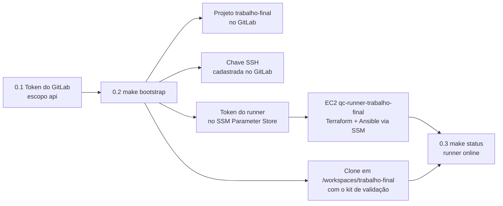
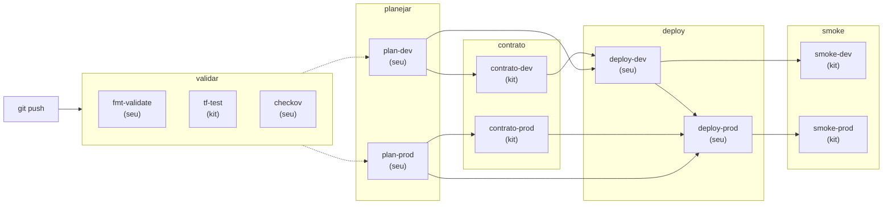

# 04 - Trabalho Final: a Quantum Commerce recria o assistente com um push

> **Segunda-feira, 9h. Uma semana depois da Aula 4 na Quantum Commerce.**
> Em um mês, a infraestrutura do **Quantum Commerce AI Customer Assistant** virou código com Terraform (Aula 2), ganhou um runner próprio configurado por Ansible (Aula 3) e passou a ser publicada por um pipeline com quality gates (Aula 4). **Helena Marques**, Head de Engenharia de IA e Entrega Contínua, abre a reunião com o Comitê de Tecnologia na agenda:
>
> > *— "Na Aula 2 a pergunta 'quanto tempo a Quantum Commerce leva para recriar do zero, de forma confiável, a infraestrutura do assistente?' virou um `terraform apply`. Mas ainda era o apply de alguém, num ambiente só. Quero levar ao Comitê a resposta final: um repositório novo, um `git push`, e a camada web do assistente de pé em **dev** e em **prod**, testada nos dois. E se algo estiver errado, quero que o pipeline diga onde antes de chegar em produção."*
>
> **Diego Tavares**, AI SRE sênior, completa:
>
> > *— "O palco eu automatizei: um `make` cria o projeto no GitLab, a chave SSH e o runner. Os testes que dizem se a infraestrutura está certa também já estão escritos, como o golden set do assistente. O seu trabalho é escrever o código que passa neles. Pipeline verde até o smoke de prod é a prova."*

Este é o **Trabalho Final** da disciplina. Ele junta num único projeto o que você praticou em `01-Terraform`, `02-Ansible` e `03-CICD`: a demo Count vira um módulo, o state vai para o S3, `dev` e `prod` viram workspaces, e um pipeline de 5 stages valida, planeja, confere o contrato, publica e testa a infraestrutura nos dois ambientes, a cada `push`.

Os comandos de terminal rodam no **terminal do Codespaces**. A leitura do pipeline e dos relatórios acontece no **GitLab**, no navegador. Comece pelo [Início de aula](../00-create-codespaces/Inicio-de-aula.md): ele sincroniza o seu fork (é o que traz esta pasta `Trabalho-final/` para o Codespaces) e recoloca credenciais AWS válidas.

> [!WARNING]
> **Pré-requisitos obrigatórios antes de começar:**
>
> - [ ] Labs de **01-Terraform** (01.1 a 01.5), **02-Ansible** (02.1) e **03-CICD** (03.1 e 03.2) concluídos
> - [ ] Fork sincronizado e credenciais AWS do Academy atualizadas no Codespaces ([Início de aula](../00-create-codespaces/Inicio-de-aula.md))
> - [ ] Bucket `base-config-<SEU-RM>` criado no [setup do ambiente](../00-create-codespaces/README.md)
> - [ ] Conta no [GitLab](https://gitlab.com) (a mesma do Módulo 02)
>
> Você **não** precisa de projeto GitLab nem de runner prontos: a Parte 0 cria os dois. Se a VPC `fiap-lab` não existir mais, ela também é criada.
>
> **Valide rapidamente** (terminal do Codespaces):
>
> ```bash
> aws sts get-caller-identity --query Account --output text
> aws s3 ls | awk '/base-config-/{print $3}'
> ls /workspaces/FIAP-Devops-CICD/Trabalho-final/Makefile
> ```
>
> Saída esperada: o número da sua conta (12 dígitos), o nome do seu bucket `base-config-...` e o caminho do `Makefile`. `ExpiredToken` na primeira linha é credencial vencida; `No such file or directory` na última é fork desatualizado. Nos dois casos, refaça o [Início de aula](../00-create-codespaces/Inicio-de-aula.md).
>
> **Tempo estimado: 3 a 4 horas.** A execução pura fica perto de 45 minutos (bootstrap ~6 min, o primeiro pipeline completo ~9 min e os seguintes ~4 min, destroy ~3 min); o resto é escrever o Terraform e o `.gitlab-ci.yml`, ler os relatórios e corrigir o que o pipeline apontar. Se dividir em duas sessões, comece a segunda por `make status` (passo 0.3).

## Principais pontos de aprendizagem

- transformar uma configuração Terraform em **módulo** reutilizável, com a quantidade de nós como variável
- separar o que é do módulo (recursos) do que é do raiz (provider, backend, chamada do módulo)
- guardar o **state no S3** com lock nativo e isolar `dev` e `prod` com **workspaces**
- nomear recursos pelo ambiente para que dois ambientes convivam na mesma conta
- escrever um pipeline com **`needs`**, promovendo de `dev` para `prod` só depois que `dev` passou
- usar testes prontos como **contrato**: ler a aba **Tests**, achar o teste vermelho e corrigir o requisito que ele aponta

## O que você terá ao final

Um projeto no GitLab em que um `git push` cria do zero, testa e publica a camada web do assistente em `dev` (1 nó) e em `prod` (3 nós), cada ambiente com o seu ALB. A entrega é um `.zip` com o código e 3 prints que provam que o pipeline ficou verde até o smoke.

Os blocos **💡 Clique para entender** trazem o porquê, a mecânica por baixo dos comandos e links oficiais; os blocos **⚠ Se der erro** só importam se o passo falhar.

## Mapa do trabalho

| Parte | O que você faz | Requisitos | Tempo |
|-------|----------------|------------|-------|
| [Parte 0](#parte-0---preparação-um-comando-prepara-o-palco) | Token do GitLab, `make bootstrap` e `make status` | [0.1](#prep-1) · [0.2](#prep-2) · [0.3](#prep-3) | ~25 min |
| [Parte 1](#parte-1---modularizar-a-demo-count) | Modularizar a demo Count e criar o raiz | [1](#req-1) · [2](#req-2) | ~45 min |
| [Parte 2](#parte-2---estado-remoto-e-ambientes-dev-e-prod) | State no S3, nomes por workspace, `dev` e `prod` | [3](#req-3) · [4](#req-4) · [5](#req-5) · [6](#req-6) | ~40 min |
| [Parte 3](#parte-3---pipeline-de-cicd-de-ponta-a-ponta) | Escrever o pipeline, subir e ler os testes | [7](#req-7) · [8](#req-8) | ~75 min |
| [Parte 4](#parte-4---empacotar-entregar-e-destruir) | Empacotar, entregar e destruir | [9](#req-9) | ~20 min |

A Parte 3 conta com uma ou duas rodadas de correção: é normal o primeiro pipeline apontar algo.

## Contexto

Cada peça foi praticada isolada, um lab por vez. Aqui elas convivem no mesmo repositório e no mesmo fluxo. A base é a demo **[01.3 - Count](../01-Terraform/demos/03-Count/README.md)**: N EC2 com Nginx servindo a página do AI Customer Assistant atrás de um ALB. Você a leva de "demo que roda do meu terminal" para "projeto que um push recria em dois ambientes".

| Aspecto | Resposta curta |
|---------|----------------|
| **Problema de negócio** | A Quantum Commerce aprendeu as ferramentas, mas o Comitê quer ver que elas se combinam num fluxo confiável, sem depender de quem clicou ou de quem rodou o `apply`. |
| **Pergunta que este trabalho responde bem** | "Conseguimos recriar a infraestrutura do assistente do zero, em dev e em prod, com um push, sabendo que ela está certa?" |
| **Pergunta que ele responde mal** | "Qual é o desenho ideal de contas e redes para isolar prod?" Workspace isola o state, não a conta nem as credenciais (você viu isso na 01.5). Isolamento multi-conta fica fora do escopo. |
| **Quando acontece na vida real** | Todo time que sai de "infra feita por pessoas" para "infra feita por pipeline" passa por este projeto de consolidação. |

### A arquitetura que você vai construir

![Arquitetura do Trabalho Final da Quantum Commerce. No Codespaces, o make bootstrap usa o token do GitLab para criar o projeto trabalho-final, cadastrar a chave SSH e criar o runner; guarda o token do runner no SSM Parameter Store e sobe a EC2 qc-runner-trabalho-final na VPC fiap-lab, configurada pelo Ansible via SSM. Um git push no projeto dispara o pipeline de 5 stages (validar, planejar, contrato, deploy, smoke) nesse runner, que acessa a AWS pelo LabRole e guarda o state no bucket base-config no S3. Por workspace, o deploy cria o ALB qc-alb-dev com 1 EC2 nginx-dev-001 e o ALB qc-alb-prod com 3 EC2 nginx-prod-001 a 003, cada ambiente com o seu target group e o seu security group; o smoke testa o DNS de cada ALB.](img/arquitetura-final.png)

*Diagrama editável: [`diagramas/arquitetura-final.excalidraw`](diagramas/arquitetura-final.excalidraw).*

---

## Parte 0 - Preparação: um comando prepara o palco

### Resultado esperado desta parte

O projeto `trabalho-final` existe no seu GitLab, o runner `qc-runner-trabalho-final` aparece **online** nele, e o clone do projeto está em `/workspaces/trabalho-final` com o kit de validação dentro.

Subir runner você já fez na mão no [Módulo 02](../02-Ansible/01-provisionando-gitlab-runner/README.md), em 28 passos. Aqui o mesmo Terraform e o mesmo playbook rodam por trás de um `make`. Nenhuma credencial AWS vai para o GitLab: o pipeline roda nessa EC2, que tem o `LabRole`.



---

<a id="prep-1"></a>

<dl>
<dt>

**0.1. Gere um Personal Access Token no GitLab, com escopo `api`**

</dt>
<dd>

No **GitLab**, abra **[Personal access tokens](https://gitlab.com/-/user_settings/personal_access_tokens)** (o caminho pelo menu é avatar → **Edit profile** → **Access** → **Personal access tokens**). Clique em **Add new token**; nas versões mais novas da tela, o botão é **Generate token** → **Legacy token**. Escolha o **Legacy token**: se a página que abrir se chamar **Generate fine-grained token** (com "Add resource permissions" em vez de uma lista de escopos), você está no tipo errado, porque o fine-grained não tem o escopo `api`. Volte e escolha **Legacy token**. Preencha:

| Campo | Valor |
|-------|-------|
| **Token name** | `trabalho-final-bootstrap` |
| **Expiration date** | daqui a 7 dias |
| **Select scopes** | marque só **`api`** |

Clique em **Create token** (ou **Generate token**) e copie o valor que começa com `glpat-`. Ele aparece **uma vez só**: se fechar a página sem copiar, gere outro.

O escopo é `api` porque o bootstrap cria projeto, chave SSH e runner pela API, e só ele cobre as três escritas (`read_api` só lê; `create_runner` não cria projeto nem chave). A tela e os escopos estão descritos em [Personal access tokens](https://docs.gitlab.com/user/profile/personal_access_tokens/#create-a-personal-access-token) e [Access token scopes](https://docs.gitlab.com/security/tokens/access_token_scopes/).

</dd>
</dl>

> [!CAUTION]
> O token com escopo `api` age como **você** no GitLab inteiro. Cole esse valor quando o `make bootstrap` pedir (passo 0.2), e nunca em arquivo do repositório, issue ou print. Ele fica só no Codespaces, em `~/.trabalho-final.env` com permissão `600`, e você o revoga no fim do trabalho (passo 9.5). A validade curta limita o estrago se ele vazar.

---

<a id="prep-2"></a>

<dl>
<dt>

**0.2. Rode o `make bootstrap` com o nome do projeto e o token**

</dt>
<dd>

No **terminal do Codespaces**, veja primeiro os comandos disponíveis:

```bash
cd /workspaces/FIAP-Devops-CICD/Trabalho-final
make help
```

> Saída esperada (o começo):
>
> ```text
> Trabalho Final - comandos (rode nesta pasta, no Codespaces)
>
>   make help               Lista os comandos disponíveis
>   make bootstrap          Cria ou reaproveita projeto GitLab, runner na AWS, chave SSH e clone com o kit (idempotente)
>   make status             Mostra runner online?, URL do projeto, último pipeline e DNS do ALB de dev e prod
>   ...
> ```

Depois rode o bootstrap. Ele pede o token do passo 0.1 sem mostrar na tela (`Cole o seu GitLab Personal Access Token ...`): cole e tecle Enter.

```bash
cd /workspaces/FIAP-Devops-CICD/Trabalho-final
make bootstrap REPO=trabalho-final
```

`REPO` aceita só o nome (o projeto nasce no **seu** usuário, o dono do token), a URL SSH (`git@gitlab.com:<seu-usuario>/trabalho-final.git`) ou a https (`https://gitlab.com/<seu-usuario>/trabalho-final`). Alternativa sem a pergunta: `make bootstrap REPO=trabalho-final GITLAB_TOKEN=glpat-...`, mas aí o token fica gravado no histórico do shell.

O comando leva **~10 a 15 minutos** (etapas `1/9` a `9/9` no log), quase todos subindo e configurando a EC2 do runner. Enquanto ele roda, leia a [Parte 1](#parte-1---modularizar-a-demo-count) e a tabela de jobs do [passo 7.2](#req-7).

> Saída esperada (o fim; ids e URLs são os seus):
>
> ```text
> Bootstrap concluído.
>   Projeto GitLab : https://gitlab.com/<seu-usuario>/trabalho-final
>   Pasta do clone : /workspaces/trabalho-final (branch master)
>   Runner         : qc-runner-trabalho-final (id 12345678, online) na EC2 i-0abc123def4567890
>   Token do runner: SSM /fiap/trabalho-final/runner-token
> ```

`REPO` e `GITLAB_TOKEN` ficam em `~/.trabalho-final.env`, e os próximos `make` não pedem de novo. Pode rodar o bootstrap quantas vezes precisar: cada etapa só cria o que falta.

</dd>
</dl>

<details>
<summary><b>💡 Clique para entender: o que cada comando do <code>make</code> faz de verdade</b></summary>
<blockquote>

Todos rodam a partir de `/workspaces/FIAP-Devops-CICD/Trabalho-final`. Nenhum deles destrói a VPC `fiap-lab`.

| Comando | O que executa por baixo | Quando usar |
|---------|-------------------------|-------------|
| `make help` | Lista os targets com a descrição de cada um. | Para lembrar os nomes. |
| `make bootstrap REPO=...` | `bootstrap/bootstrap.sh`, em 9 etapas: preflight, rede, ferramentas, chave SSH, projeto, runner no GitLab e token no SSM, EC2 do runner (Terraform), configuração (Ansible via SSM) e clone com o kit, com a espera do runner online entre as duas últimas. Salva `REPO` e `GITLAB_TOKEN` em `~/.trabalho-final.env` (`chmod 600`). | Uma vez no começo, e de novo sempre que algo da preparação quebrar ou o runner ficar `offline`. É idempotente. |
| `make status` | `bootstrap/status.sh`, só leitura: projeto e runner pela API do GitLab, último pipeline e o output `alb_dns` lido direto do state de `dev` e de `prod` no S3. | Ao voltar ao trabalho, e sempre que um pipeline ficar `pending`. |
| `make validar` | `bootstrap/validar.sh validar` no clone: `terraform fmt -check -recursive`, `init`, `validate`, `terraform test` no workspace `dev`, `plan` de `dev` e de `prod` e o `test_contrato.py` sobre cada plano. **Não roda `apply`.** | Antes de cada `push`: os mesmos testes de contrato do pipeline, em ~3 min, sem criar nada. |
| `make smoke` | `bootstrap/validar.sh smoke`: o `test_smoke.py` contra `dev` e `prod` já no ar, a partir do Codespaces. `make smoke AMBIENTE=dev` testa só um. | Depois do deploy, para conferir os ambientes sem esperar outro pipeline. |
| `make kit` | `bootstrap/bootstrap.sh kit`: recopia para o clone os arquivos do kit que estiverem diferentes (`.gitignore`, `tests/`, `validacao/`). Não toca em nenhum arquivo seu. | Se você apagou ou alterou um arquivo do kit sem querer. |
| `make destroy` | `make destroy-ambientes` e depois `make destroy-runner`. | No fim do trabalho (passo 9.4). |
| `make destroy-ambientes` | No clone: `terraform destroy` nos workspaces `dev` e `prod`. | Para derrubar só a infra do assistente e manter o runner. |
| `make destroy-runner` | `terraform destroy` da EC2 do runner, apaga o runner no GitLab pela API e apaga o parâmetro `/fiap/trabalho-final/runner-token` do SSM. | Para derrubar só o runner. |

</blockquote>
</details>

<details>
<summary><b>💡 Clique para entender: como <code>make bootstrap</code> faz cada etapa por baixo dos panos</b></summary>
<blockquote>

A numeração é a mesma do log. Cada etapa confere antes de criar; é isso que torna seguro rodar de novo.

1. **Preflight.** `aws sts get-caller-identity` confirma a credencial, e `aws s3api list-buckets` acha o bucket `base-config-*`. `aws ec2 describe-vpcs` com o filtro `tag:Name=fiap-lab` só conta as VPCs: mais de uma para aqui, porque não há como saber qual usar. No GitLab, `GET /user` valida o token e descobre o seu usuário (o namespace do projeto), e `GET /personal_access_tokens/self` confere que a lista `scopes` contém `api`. Só então `REPO` e o token são gravados em `~/.trabalho-final.env`.
2. **Rede.** Se a VPC `fiap-lab` não existe, aplica as pastas `vpc-call` e `RT-call` da [demo 01.2](../01-Terraform/demos/02-Modules/README.md), que só criam. Sem a rota para o Internet Gateway, a EC2 do runner não alcançaria o SSM nem o gitlab.com.
3. **Ferramentas.** Instala o `session-manager-plugin` (pacote `.deb` da AWS, para x86_64 ou arm64) e garante o venv `~/venv` com Ansible, `boto3` e as collections `amazon.aws` e `community.aws`, que o devcontainer já traz.
4. **Chave SSH.** Gera `~/.ssh/gitlab` se ela não existir, compara com as chaves da sua conta (`GET /user/keys`) e, se faltar, cadastra a pública com `POST /user/keys`. Escreve no `~/.ssh/config` o bloco `Host gitlab.com` com `IdentityFile ~/.ssh/gitlab` e `IdentitiesOnly yes`, e adiciona o gitlab.com ao `~/.ssh/known_hosts` com `ssh-keyscan`. Por isso este trabalho não precisa de `ssh-agent`.
5. **Projeto.** Procura `<usuario>/trabalho-final` na API. Se não existe, `POST /projects` com `name`, `path`, `visibility=public` e `initialize_with_readme=false`. Em seguida, `PUT /projects/:id` com `shared_runners_enabled=false`: sem isso, os jobs podem cair nos runners compartilhados do GitLab.com, que não têm credencial AWS.
6. **Runner no GitLab.** Procura o runner `qc-runner-trabalho-final` em `GET /projects/:id/runners?type=project_type`. O token `glrt-` só aparece na criação, então o runner existente só é reaproveitado se o SSM guarda o token **dele**; senão ele é apagado e criado de novo com `POST /user/runners` (`runner_type=project_type`, `project_id`, `description=qc-runner-trabalho-final`, `tag_list` `shell` e `terraform`, `run_untagged=true`). A resposta traz o token, que vai direto para o SSM com `PutParameter` (`Type=SecureString`) em `/fiap/trabalho-final/runner-token`. É o "Create project runner" dos passos 13 a 16 do Módulo 02, feito pela API: o token nunca passa pela tela nem por arquivo do repositório.
7. **EC2 do runner.** `terraform apply` em `bootstrap/runner/`, uma cópia do Terraform do Módulo 02 com o nome `qc-runner-trabalho-final` na EC2 e no Security Group, `t3.small` e disco de 30 GB. O state vai para `s3://base-config-<SEU-RM>/trabalho-final/runner.tfstate`, passado por `-backend-config`. Se a EC2 estiver parada (a AWS Academy para as instâncias no fim da sessão), ela é religada. Nome e state são próprios: a EC2 `quantum-ai-gitlab-runner` do Módulo 02, se ainda existir, não é tocada.
8. **Configuração.** Espera a EC2 aparecer `Online` no SSM e roda `ansible-playbook` com o mesmo `play.yaml` do Módulo 02, conectando pelo plugin `aws_ssm` (Session Manager, sem SSH e sem porta 22) e com `--extra-vars gitlab_runner_name=qc-runner-trabalho-final gitlab_runner_token_ssm_path=/fiap/trabalho-final/runner-token`. O playbook instala Terraform 1.10.5, TFLint, o `/opt/venv` com Checkov, pytest e `boto3`, o `jq` e o `gitlab-runner`, e registra o runner com o token lido do SSM. Se o runner já está online na mesma EC2 e com o mesmo token, o playbook é pulado. Depois, consulta `GET /runners/:id` até o campo `status` virar `online` (até ~5 min).
9. **Clone e kit.** `git clone` do projeto em `/workspaces/trabalho-final` (se a pasta ainda não existe), copia o kit (o mesmo que `make kit` faz) e, se algo mudou, faz o commit `chore: kit de validacao do trabalho final` e o `git push` para `master`. Esse push cria a branch no projeto vazio; como ainda não há `.gitlab-ci.yml`, nenhum pipeline roda. Por fim, imprime o resumo.

📚 Documentação oficial, na ordem das etapas:

- [Users API: Retrieve the current user](https://docs.gitlab.com/api/users/#retrieve-the-current-user) e [Personal access tokens API: Self-inform](https://docs.gitlab.com/api/personal_access_tokens/#self-inform), para as duas chamadas que validam o token e os escopos.
- [User SSH keys API: Add an SSH key](https://docs.gitlab.com/api/user_keys/#add-an-ssh-key), para o cadastro da chave pública.
- [Projects API: Create a project](https://docs.gitlab.com/api/projects/#create-a-project) e [Update a project](https://docs.gitlab.com/api/projects/#update-a-project), para `visibility` e `shared_runners_enabled`.
- [Users API: Create a runner linked to a user](https://docs.gitlab.com/api/users/#create-a-runner-linked-to-a-user), para os parâmetros do `POST /user/runners` e o token `glrt-` que ele devolve; e [Runners API: Retrieve runner's details](https://docs.gitlab.com/api/runners/#retrieve-runners-details), para os valores possíveis de `status`.
- [Parameter Store: SecureString](https://docs.aws.amazon.com/systems-manager/latest/userguide/sysman-paramstore-securestring.html) e [PutParameter](https://docs.aws.amazon.com/systems-manager/latest/APIReference/API_PutParameter.html), para como o token fica criptografado com KMS.
- [Install the Session Manager plugin](https://docs.aws.amazon.com/systems-manager/latest/userguide/session-manager-working-with-install-plugin.html) e [amazon.aws.aws_ssm connection](https://docs.ansible.com/ansible/latest/collections/amazon/aws/aws_ssm_connection.html), para o canal que o Ansible usa até a EC2.

</blockquote>
</details>

<details>
<summary><b>⚠ Se der erro: o bootstrap para com <code>ERRO:</code></b></summary>
<blockquote>

Cada `ERRO:` do bootstrap vem seguido das linhas que dizem o que fazer: credencial vencida, bucket `base-config-*` ausente, token `401 Unauthorized` ou sem escopo `api`, mais de uma VPC `fiap-lab`. Faça o que a mensagem pede e rode o `make bootstrap` de novo: ele retoma de onde parou. Dois casos pedem atenção:

- **Já existe um `trabalho-final` seu, de outra disciplina.** O bootstrap o reaproveitaria e misturaria o kit ao código antigo. Use outro nome (`REPO=trabalho-final-cicd`) e troque `/workspaces/trabalho-final` por `/workspaces/trabalho-final-cicd` em todos os comandos deste README.
- **O runner não fica `online` em ~5 minutos.** Rode o bootstrap de novo: ele religa a EC2 se ela estiver parada e reaplica o playbook. Se continuar, o `PLAY RECAP` do Ansible mostra `failed=1` e a task que quebrou; copie esse trecho ao pedir ajuda.

</blockquote>
</details>

---

<a id="prep-3"></a>

<dl>
<dt>

**0.3. Confira com `make status` o runner online e o clone com o kit**

</dt>
<dd>

```bash
cd /workspaces/FIAP-Devops-CICD/Trabalho-final
make status
```

> Saída esperada (ids e URLs são os seus):
>
> ```text
> Trabalho Final - status
>   Projeto          https://gitlab.com/<seu-usuario>/trabalho-final (id 12345678)
>   Runner           qc-runner-trabalho-final (id 12345678): online
>   Último pipeline nenhum pipeline ainda (faça o primeiro push com o .gitlab-ci.yml)
>   ALB dev          sem state ou sem output alb_dns (o deploy-dev ainda não rodou)
>   ALB prod         sem state ou sem output alb_dns (o deploy-prod ainda não rodou)
> ```

A linha que importa agora é a do **Runner**, terminando em `online`. Pipeline e ALBs aparecem depois da Parte 3.

Depois confira o clone:

```bash
cd /workspaces/trabalho-final
ls -A
git log --oneline
```

> Saída esperada:
>
> ```text
> .git  .gitignore  tests  validacao
> 1a2b3c4 (HEAD -> master, origin/master) chore: kit de validacao do trabalho final
> ```

O hash é outro no seu clone. No GitLab, **Settings → CI/CD → Runners** mostra o runner com a bolinha verde.

Na mesma página, confira duas abas. Em **Assigned project runners**, o `qc-runner-trabalho-final` aparece com a bolinha verde. Em **Instance**, a chave **Turn on instance runners for this project** precisa estar **desligada**, com a mensagem *Instance runners are turned off*. O bootstrap desliga essa chave, mas confira: com ela ligada, o GitLab pode mandar os jobs para os runners compartilhados dele, que não têm credencial da sua conta AWS, e o pipeline quebra no `terraform init`. É a mesma chave que você desligou no [passo 12 do Lab 02.1](../02-Ansible/01-provisionando-gitlab-runner/README.md#passo-12).

</dd>
</dl>

<details>
<summary><b>💡 Clique para entender: como <code>make status</code> descobre cada informação</b></summary>
<blockquote>

O `status.sh` só consulta. Projeto, runner e último pipeline vêm da API do GitLab (`GET /projects/:id/runners?type=project_type` e `GET /projects/:id/pipelines?per_page=1`); o `status` do runner é `online`, `offline`, `stale` ou `never_contacted`, e `offline` quer dizer EC2 desligada ou serviço parado. O DNS de cada ALB sai direto do objeto de state no bucket (`env:/dev/trabalho-final/terraform.tfstate` e o de `prod`), campo `outputs.alb_dns.value`, sem `terraform init`.

📚 Documentação oficial: [Runners API: List all of a project's runners](https://docs.gitlab.com/api/runners/#list-all-of-a-projects-runners), para os filtros e o campo `status`; e [Pipelines API](https://docs.gitlab.com/api/pipelines/), para os estados possíveis de um pipeline.

</blockquote>
</details>

### Checkpoint

- [ ] O projeto `trabalho-final` existe no seu GitLab.
- [ ] O `make status` mostra o runner `qc-runner-trabalho-final` **online**.
- [ ] `/workspaces/trabalho-final` tem `.gitignore`, `tests/` e `validacao/`.
- [ ] Em **Settings → CI/CD → Runners → Instance**, os instance runners estão desligados (*Instance runners are turned off*).

---

> [!IMPORTANT]
> **Daqui em diante começa o trabalho que você desenvolve.** O palco está pronto. A partir da Parte 1, o código é seu: o módulo, o raiz, o backend, os nomes por workspace e o `.gitlab-ci.yml`.

Você desenvolve **dentro do clone**, em `/workspaces/trabalho-final`: é dele que sai o `git push` da Parte 3. Ele fica ao lado do repositório do curso e pode não aparecer no explorer do Codespaces; para abrir um arquivo no editor, use `code <caminho>`.

O kit que veio no clone é o **contrato** que o seu código precisa cumprir. Não edite esses arquivos: o pipeline usa exatamente eles.

| Arquivo do kit | O que confere | Quando roda |
|----------------|---------------|-------------|
| `tests/modulo.tftest.hcl` | O módulo isolado, em dois blocos `run` (`um_no` e `tres_nos`): quantidade de EC2, de attachments e de provisionamentos, nomes `nginx-<env>-00N`, ALB, Target Group e Security Group com o workspace no nome, Security Group sem o prefixo `sg-`, output `alb_dns`. | Job `tf-test` e `make validar` |
| `validacao/test_contrato.py` | O plano de cada ambiente e o próprio `.gitlab-ci.yml`, em 44 testes: backend, nada de state ou plano no Git, provider só no raiz, nenhum recurso fora do módulo, recursos da demo mantidos, `node_count` ligado ao workspace, quantidade e nomes exatos, output `alb_dns`; e, no pipeline, stages, jobs, `needs`, tags, o mínimo de cada job seu e os relatórios JUnit. | Jobs `contrato-dev`/`contrato-prod` e `make validar` |
| `validacao/test_smoke.py` | A infraestrutura no ar, em 7 testes: o ALB responde a página do assistente, o número de máquinas, de hosts e de alvos saudáveis bate com o ambiente. | Jobs `smoke-dev`/`smoke-prod` e `make smoke` |
| `validacao/conftest.py`, `validacao/pytest.ini` | As opções `--ambiente`, `--plan` e `--alb-dns` e a configuração do pytest. | Junto com os dois acima |
| `.gitignore` | Deixa `.terraform/`, state, planos e relatórios fora do Git. | Em todo `git add` |

---

## Parte 1 - Modularizar a demo Count

### Resultado esperado desta parte

A demo Count vira um módulo em `modules/web-cluster/` que recebe a quantidade de nós por variável, e um arquivo raiz o chama. `terraform validate` passa.

---

<a id="req-1"></a>

### Requisito 1. Transformar a demo Count em um módulo

<dl>
<dt>

**1.1. Copie TODOS os arquivos da demo Count para a pasta do módulo**

</dt>
<dd>

Todos os `.tf`, o `script.sh` **e a pasta `site/`**:

```bash
cd /workspaces/trabalho-final
mkdir -p modules/web-cluster
cp -r /workspaces/FIAP-Devops-CICD/01-Terraform/demos/03-Count/*.tf \
      /workspaces/FIAP-Devops-CICD/01-Terraform/demos/03-Count/script.sh \
      /workspaces/FIAP-Devops-CICD/01-Terraform/demos/03-Count/site \
      modules/web-cluster/
ls modules/web-cluster modules/web-cluster/site
```

> Saída esperada:
>
> ```text
> modules/web-cluster:
> check.tf  main.tf  outputs.tf  script.sh  securitygroup.tf  site  variables.tf  versions.tf
>
> modules/web-cluster/site:
> index.html
> ```

Copie tudo, não escolha recursos soltos: o `terraform_data.provisiona` lê o `script.sh` e o `site/index.html`, o `check.tf` usa o provider `http` declarado no `versions.tf`, e o `tf-test` exige o `check.tf` no módulo.

</dd>
<dt>

**1.2. Apague do módulo o bloco `provider "aws"`**

</dt>
<dd>

Abra o `main.tf` do módulo:

```bash
cd /workspaces/trabalho-final
code modules/web-cluster/main.tf
```

Apague o bloco `provider "aws" { ... }` do topo do arquivo, do comentário `# Provider declarado uma vez na raiz desta demo.` até a chave que fecha o provider (são as 13 primeiras linhas). Salve e confira que não sobrou nenhum provider no módulo:

```bash
cd /workspaces/trabalho-final
grep -rn 'provider "aws"' modules/ || echo "nenhum provider no modulo"
```

> Saída esperada:
>
> ```text
> nenhum provider no modulo
> ```

Mantenha os nomes locais dos recursos como vieram (`aws_instance.web`, `aws_lb.web`, `terraform_data.provisiona`...): os testes procuram por eles. O `default_tags` pode ir para o provider do raiz no passo 2.1.

</dd>
<dt>

**1.3. Troque o `count = 2` pela variável `node_count`**

</dt>
<dd>

No `variables.tf` do módulo, declare a variável `node_count` com `type = number` e **sem `default`**: o raiz sempre passa o valor, e sem default o Terraform reclama se ele esquecer. No `main.tf`, use `var.node_count` no `count` do `aws_instance.web`, no lugar do `2`. Os outros `count` da demo usam `length(aws_instance.web)` e acompanham sozinhos.

</dd>
<dt>

**1.4. Renomeie o output `alb_public` para `alb_dns`**

</dt>
<dd>

No `outputs.tf` do módulo, troque o nome do output `alb_public` por `alb_dns`; o valor continua `aws_lb.web.dns_name`. O output `address` pode ficar como está.

</dd>
</dl>

📚 Fronteira do módulo, variáveis de entrada e `source`: demo **[01.2 - Módulos](../01-Terraform/demos/02-Modules/README.md)**. O `count` e o `length(aws_instance.web)`: demo **[01.3 - Count](../01-Terraform/demos/03-Count/README.md)**.

<details>
<summary><b>💡 Clique para entender: por que o provider sai do módulo e a quantidade vira variável</b></summary>
<blockquote>

Um módulo é como uma função: variáveis são os parâmetros, outputs são o retorno. O provider é decisão de quem chama (região, credenciais, tags); um módulo com provider próprio não aceita `count` nem `for_each` no bloco `module`. E com `node_count` no lugar do `2`, quem chama decide o tamanho e o módulo decide como construir.

📚 Documentação oficial: [Providers within modules](https://developer.hashicorp.com/terraform/language/modules/develop/providers), para a regra de deixar o provider no raiz; e [Input variables](https://developer.hashicorp.com/terraform/language/values/variables), para `type = number`.

</blockquote>
</details>

<details>
<summary><b>⚠ Se der erro: <code>Unreadable module directory</code> em <code>tests/modulo.tftest.hcl</code> no <code>terraform init</code></b></summary>
<blockquote>

O `tests/modulo.tftest.hcl` do kit testa o módulo em `./modules/web-cluster`, e essa pasta não existe: o código ficou no raiz, ou o módulo está em outra pasta. Esse erro vem do próprio Terraform, antes dos testes do kit rodarem, por isso não cita o Requisito. Crie o módulo nesse caminho exato e chame-o pelo raiz (Requisitos 1 e 2).

</blockquote>
</details>

<details>
<summary><b>⚠ Se der erro: <code>Call to function "filesha256" failed: open modules/web-cluster/site/index.html: no such file or directory</code></b></summary>
<blockquote>

O Terraform para antes de qualquer teste: faltou copiar a pasta `site/`. Copie e rode de novo:

```bash
cd /workspaces/trabalho-final
cp -r /workspaces/FIAP-Devops-CICD/01-Terraform/demos/03-Count/site modules/web-cluster/
```

</blockquote>
</details>

<details>
<summary><b>⚠ Se der erro: <code>Missing expected failure</code> no <code>terraform test</code></b></summary>
<blockquote>

O `check.tf` sumiu do módulo. O `tests/modulo.tftest.hcl` espera o aviso do `check "alb_esta_no_ar"` (em `plan` o ALB ainda não existe) e reprova sem ele. Copie o arquivo de volta (Requisito 1):

```bash
cd /workspaces/trabalho-final
cp /workspaces/FIAP-Devops-CICD/01-Terraform/demos/03-Count/check.tf modules/web-cluster/
```

</blockquote>
</details>

---

<a id="req-2"></a>

### Requisito 2. Criar o arquivo raiz que chama o módulo

O raiz fica na pasta do projeto, fora de `modules/`. Ele configura o provider, chama o módulo com a quantidade de nós de cada ambiente e reexpõe o DNS do ALB.

<dl>
<dt>

**2.1. Declare o `provider "aws"` no `main.tf` do raiz**

</dt>
<dd>

Crie `/workspaces/trabalho-final/main.tf` com o `provider "aws"` e `region = "us-east-1"`. O `backend` também é do raiz, mas entra no Requisito 3.

</dd>
<dt>

**2.2. Chame o módulo com `source = "./modules/web-cluster"`**

</dt>
<dd>

No mesmo `main.tf`, um bloco `module` apontando para a pasta do módulo. O nome do bloco é livre (`web_cluster`, por exemplo); os testes procuram a chamada pelo `source`.

</dd>
<dt>

**2.3. Passe `node_count` a partir do workspace: 1 em `dev`, 3 em `prod`**

</dt>
<dd>

```hcl
node_count = terraform.workspace == "prod" ? 3 : 1
```

Escreva a expressão direto no bloco `module`, sem passar por `local` nem variável: o teste de contrato lê as referências da expressão no plan e não enxerga através de `locals`. Assim o pipeline não precisa de `-var` nem de `tfvars`: basta selecionar o workspace.

</dd>
<dt>

**2.4. Crie o output `alb_dns` no raiz**

</dt>
<dd>

Num `outputs.tf` na raiz do projeto, um output **`alb_dns`** que devolve `module.<nome_do_bloco>.alb_dns`. É esse output que os jobs `smoke-*` leem com `terraform output -raw alb_dns`, e que o `make status` lê direto do state no S3.

</dd>
<dt>

**2.5. Valide a sintaxe localmente**

</dt>
<dd>

```bash
cd /workspaces/trabalho-final
terraform init -backend=false
terraform fmt -recursive
terraform validate
```

> Saída esperada (a última linha):
>
> ```text
> Success! The configuration is valid.
> ```

O `-backend=false` deixa validar antes do `backend.tf` existir. O `fmt -recursive` formata; o job `fmt-validate` roda `fmt -check -recursive`, que reprova código fora da formatação.

</dd>
</dl>

📚 Chamar um módulo, passar variável e reexpor output: demo **[01.2 - Módulos](../01-Terraform/demos/02-Modules/README.md)**. O `terraform.workspace` e os workspaces: demo **[01.5 - Workspaces](../01-Terraform/demos/05-Workspaces/README.md)** (lá o valor sai de um mapa em `locals` com `lookup`; aqui a condicional fica direto no `module`).

<details>
<summary><b>⚠ Se der erro: <code>already exists</code> no deploy depois de renomear o bloco <code>module</code></b></summary>
<blockquote>

O nome do bloco faz parte do endereço no state: `module.web_cluster.aws_lb.web` e `module.web.aws_lb.web` são recursos diferentes para o Terraform. Renomear o bloco depois do primeiro deploy faz o plano destruir a frota inteira e recriá-la (`13 to add, 0 to change, 13 to destroy` em prod), e o apply cria os novos antes de apagar os antigos, com os mesmos nomes `qc-*`:

> ```text
> Error: ELBv2 Target Group (qc-tg-dev) already exists
> Error: creating Security Group (qc-web-dev): ... StatusCode: 400
> ```

Se ainda não fez o push, mantenha o nome novo e declare no raiz um `moved`, que muda só o endereço no state, sem destruir nada:

```hcl
moved {
  from = module.web_cluster
  to   = module.web
}
```

O `plan` mostra `has moved to` e nenhuma destruição. É o mesmo `moved` da [Parte 4 da demo 01.2](../01-Terraform/demos/02-Modules/README.md#parte-4---refatorando-sem-destruir-moved).

Se o deploy já falhou no meio, **não volte o nome do bloco**: isso é uma nova troca de endereço e repete a colisão. Rode o pipeline de novo (**Build → Pipelines → Run pipeline**): na primeira rodada o Terraform apagou os recursos com o endereço antigo, então na seguinte os nomes estão livres e o `apply` cria a frota com o endereço novo. Cada ambiente fica fora do ar até essa rodada terminar.

</blockquote>
</details>

<details>
<summary><b>⚠ Se der erro: <code>Unsupported attribute</code> ou <code>"node_count" is required</code></b></summary>
<blockquote>

- `Unsupported attribute` ... `"alb_dns"`: o raiz consome `module.<nome>.alb_dns`, mas o output do módulo tem outro nome. Volte ao passo 1.4.
- `Missing required argument` ... `"node_count" is required`: o bloco `module` do raiz não passou o valor. Volte ao passo 2.3.

</blockquote>
</details>

### Checkpoint

- [ ] `modules/web-cluster/` tem os 6 `.tf`, o `script.sh` e a pasta `site/`, sem `provider`.
- [ ] O módulo declara `node_count` e expõe `alb_dns`.
- [ ] O raiz tem o provider, a chamada do módulo e o output `alb_dns`, e o `terraform validate` passa.

---

## Parte 2 - Estado remoto e ambientes dev e prod

### Resultado esperado desta parte

O state vive no S3, os recursos levam o nome do ambiente, e os workspaces `dev` e `prod` planejam 1 e 3 nós. O `make validar` passa.

---

<a id="req-3"></a>

### Requisito 3. Guardar o state no S3

<dl>
<dt>

**3.1. Descubra o nome do seu bucket**

</dt>
<dd>

```bash
aws s3 ls | awk '/base-config-/{print $3; exit}'
```

A saída é o nome do bucket do setup, como `base-config-12345`.

</dd>
<dt>

**3.2. Crie o `backend.tf` na raiz do projeto**

</dt>
<dd>

Em `/workspaces/trabalho-final/backend.tf`, um bloco `terraform { backend "s3" { ... } }` com estes quatro valores:

| Atributo | Valor |
|----------|-------|
| `bucket` | o nome do passo 3.1 |
| `key` | exatamente `trabalho-final/terraform.tfstate` |
| `region` | `us-east-1` |
| `use_lockfile` | `true` |

</dd>
<dt>

**3.3. Inicialize o backend**

</dt>
<dd>

```bash
cd /workspaces/trabalho-final
terraform init
```

> Saída esperada (as linhas que importam):
>
> ```text
> Successfully configured the backend "s3"! Terraform will automatically
> use this backend unless the backend configuration changes.
> ...
> Terraform has been successfully initialized!
> ```

</dd>
<dt>

**3.4. Confira o `.gitignore` que veio no kit**

</dt>
<dd>

```bash
cd /workspaces/trabalho-final
grep -v '^#' .gitignore | grep .
```

> Saída esperada:
>
> ```text
> .terraform/
> *.tfstate
> *.tfstate.*
> *.tfplan
> plan-*.json
> contrato-*.xml
> smoke-*.xml
> checkov-report.xml
> .pytest_cache/
> __pycache__/
> ```

Sem ele, o `git add` do passo 8.2 levaria ao GitLab os providers (centenas de MB) e o state, com dados sensíveis em texto claro. Se o arquivo sumiu, `make kit` o recria. O `.terraform.lock.hcl` fica fora da lista de propósito: versionado, fixa a mesma versão dos providers no Codespaces e no runner e faz o cache de providers do pipeline funcionar.

</dd>
</dl>

📚 O bloco `backend "s3"`, o `use_lockfile` e o `init` configurando o backend: demo **[01.4 - State remoto](../01-Terraform/demos/04-State/README.md)**, passo 4 e o bloco "o bloco backend s3".

<details>
<summary><b>💡 Clique para entender: a key do state com workspaces</b></summary>
<blockquote>

Com workspaces, o `default` usa a key como está e os outros ganham um prefixo: `env:/dev/trabalho-final/terraform.tfstate` e `env:/prod/trabalho-final/terraform.tfstate`. Por isso `dev` e `prod` nunca se sobrescrevem, e o lock de um não trava o outro. O runner usa outra key (`trabalho-final/runner.tfstate`), e as demos, as delas.

📚 Documentação oficial: [Backend S3](https://developer.hashicorp.com/terraform/language/backend/s3), para `use_lockfile` e o prefixo `workspace_key_prefix`, que por padrão é `env:`.

</blockquote>
</details>

<details>
<summary><b>⚠ Se der erro: <code>test_backend_key</code> reprovou, ou o <code>plan</code> quer criar tudo de novo</b></summary>
<blockquote>

A `key` do `backend.tf` não é `trabalho-final/terraform.tfstate`. Com outra key, o Terraform lê um state novo e vazio e planeja recriar a frota inteira: o contrato barra antes do deploy, porque os nomes `qc-*` já existem e o apply colidiria. Corrija a key e rode `terraform init -reconfigure`. O state vazio criado na key errada fica no bucket (`env:/dev/trabalho-final/<key-errada>`) e não custa nada; pode apagá-lo com `aws s3 rm s3://base-config-<RM>/env:/dev/trabalho-final/<key-errada>` (e o de `prod`). Nunca apague a key `terraform.tfstate`.

</blockquote>
</details>

<details>
<summary><b>⚠ Se der erro: <code>NoSuchBucket</code>, <code>bucket does not exist</code> ou <code>The value cannot be empty</code></b></summary>
<blockquote>

O `bucket` do `backend.tf` está errado ou vazio (nome de bucket não tem espaço nem maiúscula). Corrija com o nome do passo 3.1 e reconfigure:

```bash
cd /workspaces/trabalho-final
terraform init -reconfigure
```

</blockquote>
</details>

---

<a id="req-4"></a>

### Requisito 4. Nomear as máquinas pelo workspace

<dl>
<dt>

**4.1. Inclua o workspace na tag `Name` do `aws_instance.web`**

</dt>
<dd>

A demo gera `nginx-001`, `nginx-002` com `format("nginx-%03d", count.index + 1)`. Acrescente `terraform.workspace` ao formato para o resultado ficar assim:

| Workspace | Tags `Name` esperadas |
|-----------|-----------------------|
| `dev` | `nginx-dev-001` |
| `prod` | `nginx-prod-001`, `nginx-prod-002`, `nginx-prod-003` |

</dd>
</dl>

📚 Concatenar o workspace no nome de um recurso: demo **[01.5 - Workspaces](../01-Terraform/demos/05-Workspaces/README.md)**.

---

<a id="req-5"></a>

### Requisito 5. Nomear ALB, Target Group e Security Group pelo workspace

<dl>
<dt>

**5.1. Troque os nomes fixos da demo pelos nomes com o workspace**

</dt>
<dd>

| Recurso (arquivo do módulo) | Nome na demo | Nome em `dev` | Nome em `prod` |
|-----------------------------|--------------|---------------|----------------|
| `aws_lb.web` (`main.tf`) | `quantum-ai-alb` | `qc-alb-dev` | `qc-alb-prod` |
| `aws_lb_target_group.web` (`main.tf`) | `quantum-ai-tg` | `qc-tg-dev` | `qc-tg-prod` |
| `aws_security_group.web` (`securitygroup.tf`), no `name` **e** na tag `Name` | `quantum-ai-http` | `qc-web-dev` | `qc-web-prod` |

Com os nomes fixos da demo, `dev` e `prod` tentariam criar o mesmo ALB e o segundo deploy falharia com `already exists`.

</dd>
</dl>

<details>
<summary><b>⚠ Se der erro: <code>invalid value for name (cannot begin with sg-)</code> ou <code>"name" cannot be longer than 32 characters</code></b></summary>
<blockquote>

O provider AWS recusa o nome já no `validate`, antes de qualquer teste, então o erro aparece no `make validar`, no `fmt-validate`, no `tf-test` e no `plan`, sem citar o Requisito: é o Requisito 5. O prefixo `sg-` é reservado aos IDs de Security Group (`sg-0abc...`); ALB e Target Group aceitam no máximo 32 caracteres, só letras, números e hífens. Volte aos nomes da tabela do passo 5.1, no `name` e na tag `Name`.

</blockquote>
</details>

---

<a id="req-6"></a>

### Requisito 6. Criar os ambientes dev e prod

<dl>
<dt>

**6.1. Crie os workspaces `dev` e `prod`**

</dt>
<dd>

```bash
cd /workspaces/trabalho-final
terraform workspace select -or-create=true dev
terraform workspace select -or-create=true prod
terraform workspace list
```

> Saída esperada (a última parte):
>
> ```text
>   default
>   dev
> * prod
> ```

O `*` marca o atual. O `-or-create=true` cria o workspace só se ele não existe: o bloco roda sem erro numa segunda sessão, depois do `make validar` ou de um pipeline.

</dd>
<dt>

**6.2. Planeje os dois ambientes e confira a diferença**

</dt>
<dd>

Não rode `apply`: quem cria a infraestrutura é o pipeline. O `plan` só calcula.

```bash
cd /workspaces/trabalho-final
terraform workspace select dev && terraform plan -no-color | grep -E '^Plan:'
terraform workspace select prod && terraform plan -no-color | grep -E '^Plan:'
```

> Saída esperada:
>
> ```text
> Plan: 7 to add, 0 to change, 0 to destroy.
> Plan: 13 to add, 0 to change, 0 to destroy.
> ```

São 4 recursos fixos (ALB, Target Group, listener e Security Group) mais, por nó, 1 EC2, 1 provisionamento e 1 attachment. Outro número quer dizer que o `node_count` não está seguindo o workspace (passo 2.3).

</dd>
<dt>

**6.3. Rode a validação local com `make validar`**

</dt>
<dd>

É o **go/no-go** antes do pipeline: os mesmos testes de contrato que o GitLab vai rodar, sobre os planos de `dev` e `prod`, sem `apply`.

```bash
cd /workspaces/FIAP-Devops-CICD/Trabalho-final
make validar
```

O comando leva ~3 minutos e termina com um resumo por etapa. Antes do Requisito 7, os 10 testes do pipeline aparecem como `SKIPPED ... ainda não há .gitlab-ci.yml (Requisito 7)`: é o esperado nesta parte.

> Saída esperada (o fim):
>
> ```text
> Resultado do make validar em /workspaces/trabalho-final
>   ok     terraform fmt -check -recursive
>   ok     terraform init
>   ok     terraform validate
>   ok     terraform test (workspace dev)
>   ok     terraform plan (dev)
>   ok     test_contrato.py --ambiente dev
>   ok     terraform plan (prod)
>   ok     test_contrato.py --ambiente prod
>
> Tudo verde. Pode fazer o push: git -C /workspaces/trabalho-final push
> ```

Uma linha `FALHOU` aponta a etapa; logo acima dela, cada teste reprovado diz o que está errado, o valor encontrado contra o esperado e o **Requisito** a revisar. Corrija e rode de novo, quantas vezes precisar.

</dd>
</dl>

<details>
<summary><b>💡 Clique para entender: como <code>make validar</code> roda os testes por baixo dos panos</b></summary>
<blockquote>

O `validar.sh` roda no clone, na ordem do resumo: `fmt -check`, `init`, `validate` (se falhar, para aqui), `terraform test` no workspace `dev` e, para cada ambiente, `plan -lock=false -out=plan-<env>.tfplan`, `show -json` e `pytest validacao/test_contrato.py`. O pytest usa um venv próprio, `~/.venv-trabalho-final`, criado na primeira vez. No fim, ele volta ao workspace em que você estava.

O `tftest` usa um bloco `module { source = "./modules/web-cluster" }` com `command = plan` para testar o **módulo isolado** com `node_count` 1 e 3. O `test_contrato.py` lê o JSON do plano, não o seu código como texto: a seção `configuration` traz as expressões (`var.node_count`, `terraform.workspace`), a `planned_values` traz os nomes, e o `.terraform/terraform.tfstate` do `init` traz o backend.

📚 Documentação oficial: [Terraform tests](https://developer.hashicorp.com/terraform/language/tests), para os blocos `run`, `module` e `assert`; e [JSON output format](https://developer.hashicorp.com/terraform/internals/json-format), para a estrutura do plano que o pytest percorre.

</blockquote>
</details>

### Checkpoint

- [ ] `backend.tf` aponta para o seu bucket com a key `trabalho-final/terraform.tfstate` e `use_lockfile = true`.
- [ ] EC2, ALB, Target Group e Security Group levam o workspace no nome.
- [ ] `dev` planeja 7 recursos e `prod`, 13.
- [ ] `make validar` termina com `Tudo verde.`, sem nenhuma linha `FALHOU`.

---

## Parte 3 - Pipeline de CI/CD de ponta a ponta

### Resultado esperado desta parte

Um `push` dispara o pipeline de 5 stages no seu runner: valida, planeja os dois ambientes, confere o contrato, publica `dev` e depois `prod`, e testa os dois no ar. Tudo verde até `smoke-prod`.



Setas cheias são `needs`: o job só começa quando os de origem terminam verdes. As tracejadas são a ordem dos stages: os `plan` esperam o `validar` inteiro. A seta `deploy-dev → deploy-prod` é a promoção: **`prod` só é publicado depois que `dev` subiu**.

---

<a id="req-7"></a>

### Requisito 7. Escrever o pipeline de 5 stages

Cada stage tem jobs do **kit** (prontos, você copia) e jobs **seus** (você escreve):

| Stage | Jobs do kit (copie do passo 7.1) | Jobs seus (escreva no passo 7.2) |
|-------|----------------------------------|----------------------------------|
| `validar` | `tf-test` | `fmt-validate`, `checkov` |
| `planejar` | | `plan-dev`, `plan-prod` |
| `contrato` | `contrato-dev`, `contrato-prod` | |
| `deploy` | | `deploy-dev`, `deploy-prod` |
| `smoke` | `smoke-dev`, `smoke-prod` | |

<dl>
<dt>

**7.1. Crie o `.gitlab-ci.yml` com os stages e os jobs do kit**

</dt>
<dd>

```bash
cd /workspaces/trabalho-final
code .gitlab-ci.yml
```

Cole o conteúdo abaixo e salve. Os comentários `(seu)` marcam onde entram os jobs do passo 7.2.

```yaml
---
stages:
  - validar
  - planejar
  - contrato
  - deploy
  - smoke

default:
  # Cache de providers no home do usuario do runner: o provider AWS tem centenas de
  # MB e, sem cache, cada job baixaria tudo de novo no terraform init. Fica no
  # before_script (e nao em variables:) porque $HOME so existe no shell do runner.
  before_script:
    - export TF_PLUGIN_CACHE_DIR="$HOME/.terraform.d/plugin-cache"
    - mkdir -p "$TF_PLUGIN_CACHE_DIR"

# ---------- STAGE validar ----------

# (seu) fmt-validate

# kit: testa o modulo isolado com node_count 1 e 3, sem criar nada.
tf-test:
  stage: validar
  script:
    - terraform init
    - terraform workspace select dev || terraform workspace new dev
    - terraform test
  tags:
    - shell

# (seu) checkov

# ---------- STAGE planejar ----------

# (seu) plan-dev
# (seu) plan-prod

# ---------- STAGE contrato ----------

# kit: confere o plan de cada ambiente contra o contrato, antes de qualquer apply.
contrato-dev:
  stage: contrato
  needs: [plan-dev]
  script:
    - terraform init
    - terraform show -json plan-dev.tfplan > plan-dev.json
    - source /opt/venv/bin/activate
    - pytest validacao/test_contrato.py --ambiente dev --plan plan-dev.json --junitxml contrato-dev.xml
  artifacts:
    when: always
    paths:
      - contrato-dev.xml
    reports:
      junit: contrato-dev.xml
  tags:
    - shell

contrato-prod:
  stage: contrato
  needs: [plan-prod]
  script:
    - terraform init
    - terraform show -json plan-prod.tfplan > plan-prod.json
    - source /opt/venv/bin/activate
    - pytest validacao/test_contrato.py --ambiente prod --plan plan-prod.json --junitxml contrato-prod.xml
  artifacts:
    when: always
    paths:
      - contrato-prod.xml
    reports:
      junit: contrato-prod.xml
  tags:
    - shell

# ---------- STAGE deploy ----------

# (seu) deploy-dev
# (seu) deploy-prod

# ---------- STAGE smoke ----------

# kit: testa a infraestrutura publicada pelo DNS do ALB de cada ambiente.
smoke-dev:
  stage: smoke
  needs: [deploy-dev]
  script:
    - terraform init
    - terraform workspace select dev
    - ALB_DNS=$(terraform output -raw alb_dns)
    - source /opt/venv/bin/activate
    - pytest validacao/test_smoke.py --ambiente dev --alb-dns "$ALB_DNS" --junitxml smoke-dev.xml
  artifacts:
    when: always
    paths:
      - smoke-dev.xml
    reports:
      junit: smoke-dev.xml
  tags:
    - shell

smoke-prod:
  stage: smoke
  needs: [deploy-prod]
  script:
    - terraform init
    - terraform workspace select prod
    - ALB_DNS=$(terraform output -raw alb_dns)
    - source /opt/venv/bin/activate
    - pytest validacao/test_smoke.py --ambiente prod --alb-dns "$ALB_DNS" --junitxml smoke-prod.xml
  artifacts:
    when: always
    paths:
      - smoke-prod.xml
    reports:
      junit: smoke-prod.xml
  tags:
    - shell
```

O `before_script` do `default` vale para todos os jobs, inclusive os seus; não defina outro `before_script` neles, senão o do `default` deixa de valer. Cada job leva `tags: [shell]`, como nos labs 03.1 e 03.2: os seus também.

</dd>
<dt>

**7.2. Escreva os seus 6 jobs nos lugares marcados com `(seu)`**

</dt>
<dd>

Os nomes, os stages, os `needs` e os artefatos precisam ser exatamente estes, porque os jobs do kit dependem deles (o `contrato-dev` procura o `plan-dev.tfplan` que vem do `plan-dev`). Todos com `tags: [shell]`. O `test_contrato.py` também lê o seu `.gitlab-ci.yml`: apagar ou relaxar um job (`allow_failure`, `when: manual`, `rules`/`only`, `|| true`, um `needs` a menos) deixa o `contrato-*` vermelho. Ele também confere o efeito mínimo de cada job seu, sem exigir a forma exata: o `deploy-<env>` seleciona o workspace e aplica o `plan-<env>.tfplan`, o `plan-<env>` gera e publica esse arquivo, o `fmt-validate` roda `fmt -check` e `validate`, e o `checkov` publica o JUnit.

| Job | Stage | `needs` | O que precisa fazer | Artefato |
|-----|-------|---------|---------------------|----------|
| `fmt-validate` | `validar` | | `terraform fmt -check -recursive`, `terraform init -backend=false` (como no Lab 03.2: validar não precisa do state) e `terraform validate`. | |
| `checkov` | `validar` | | Rodar o Checkov sobre o projeto com saída JUnit, **reportando sem barrar** (`\|\| true`), e publicar o relatório na aba Tests. | `checkov-report.xml` (o nome do Lab 03.2 e do `.gitignore` do kit), como `reports: junit` |
| `plan-dev` | `planejar` | | `init`, selecionar o workspace `dev` (criando se não existir) e `terraform plan -out=plan-dev.tfplan`. | `plan-dev.tfplan` |
| `plan-prod` | `planejar` | | O mesmo, no workspace `prod`, gerando `plan-prod.tfplan`. | `plan-prod.tfplan` |
| `deploy-dev` | `deploy` | `plan-dev`, `contrato-dev` | `init`, `terraform workspace select dev` (sem criar: o `plan-dev` já criou o workspace) e `terraform apply -auto-approve plan-dev.tfplan`. | |
| `deploy-prod` | `deploy` | `plan-prod`, `contrato-prod`, `deploy-dev` | O mesmo, com `terraform workspace select prod` e `plan-prod.tfplan`. | |

Você já escreveu cada peça: o `plan -out` com artefato até o `apply` no [Lab 03.1, passo 5](../03-CICD/01-Primeiro-pipeline/README.md#passo-5); o `fmt-validate` e o `checkov` com `|| true` e `reports: junit` no [Lab 03.2, passo 5](../03-CICD/02-Validando-e-gerando-relatorios/README.md#passo-5); o workspace no job é o mesmo `select || new` do `tf-test`. O novo é juntar tudo em dois ambientes com `needs`.

</dd>
</dl>

<details>
<summary><b>💡 Clique para entender: <code>needs</code>, artefatos e por que dev vem antes de prod</b></summary>
<blockquote>

- **Stage sem `needs`** espera o stage anterior inteiro: nada é planejado se o `tf-test` ou o `fmt-validate` reprovaram.
- **`needs`** troca essa espera por uma lista e diz de quais jobs o artefato é baixado. Um contrato vermelho barra o deploy daquele ambiente.
- **`deploy-dev` em `deploy-prod`** é a promoção: se `dev` falhar, `prod` não é tocado.
- **Aplicar o plano salvo** garante que o `apply` faz exatamente o que o contrato aprovou.
- **O Checkov reporta sem barrar**, como no Lab 03.2: a camada web da demo tem achados conhecidos (HTTP sem TLS, ALB sem WAF nem log de acesso, IMDSv1) que são assunto de revisão de segurança, não de aula. O contrato e o smoke barram; o Checkov informa.

📚 Documentação oficial: [`needs`](https://docs.gitlab.com/ci/yaml/#needs), para as regras de ordem e de download de artefatos; [`default`](https://docs.gitlab.com/ci/yaml/#default), para o que é herdado por todos os jobs; e [relatórios JUnit](https://docs.gitlab.com/ci/testing/unit_test_reports/), para o que a aba Tests mostra.

</blockquote>
</details>

<details>
<summary><b>⚠ Se der erro: o pipeline não aparece, ou aparece com <code>yaml invalid</code> / <code>undefined need</code></b></summary>
<blockquote>

Indentação errada ou um `needs` com nome que não existe (`plan_dev` em vez de `plan-dev`). Em **Build → Pipeline editor**, a aba **Validate** mostra a linha do problema; confira os nomes contra a tabela do passo 7.2.

</blockquote>
</details>

---

<a id="req-8"></a>

### Requisito 8. Validar, subir e ler o pipeline

<dl>
<dt>

**8.1. Rode o `make validar` de novo**

</dt>
<dd>

É o último ponto barato para pegar um erro: 3 minutos aqui contra ~20 de um pipeline.

```bash
cd /workspaces/FIAP-Devops-CICD/Trabalho-final
make validar
```

Siga só se terminar em `Tudo verde.`

</dd>
<dt>

**8.2. Formate, faça o commit e o push**

</dt>
<dd>

```bash
cd /workspaces/trabalho-final
terraform fmt -recursive
git add .
git status --short
git commit -m "feat: modulo web-cluster, workspaces e pipeline"
git push origin master
```

O `git status --short` deve listar o `.gitlab-ci.yml`, o `.terraform.lock.hcl`, o `main.tf`, o `outputs.tf`, o `backend.tf` e `modules/`, sem `.terraform/` nem `*.tfplan`. O push termina com `master -> master` e dispara o pipeline. Não há `ssh-agent` aqui: o `make bootstrap` deixou o `~/.ssh/config` apontando para a chave.

</dd>
<dt>

**8.3. Acompanhe o pipeline até o `smoke-prod`**

</dt>
<dd>

No **GitLab**, abra **Build → Pipelines** e clique no pipeline mais recente. O runner executa um job por vez, e o pipeline completo leva **~9 minutos** na primeira vez, criando dev e prod do zero, e ~4 minutos nos seguintes (na primeira vez, cada `deploy` leva ~3 min, quase todo o tempo criando o ALB; cada `smoke`, ~20 s). Enquanto ele roda, leia o passo 8.4.

Pipeline verde até o `smoke-prod` quer dizer que o trabalho está certo: o código cumpre o contrato e a infraestrutura responde como deveria nos dois ambientes.

> 📸 **Print obrigatório** — salve como `prints/01-pipeline-verde.png`. Capture a página do pipeline com os **5 stages verdes** (`validar`, `planejar`, `contrato`, `deploy`, `smoke`) e os 11 jobs visíveis.

O verde só vale com os 11 jobs. O `contrato-*` reprova se faltar `tf-test` ou um `smoke-*`, mas um `.gitlab-ci.yml` sem o próprio `contrato-*` fica verde porque nenhum teste roda: por isso a entrega pede este print com os 5 stages e os dois seguintes com as suítes `contrato-*` e `smoke-*` na aba Tests.

</dd>
<dt>

**8.4. Leia a aba Tests e corrija o que estiver vermelho**

</dt>
<dd>

Na página do pipeline, clique na aba **Tests**. Cada job que publica JUnit vira uma linha com o nome do job: `checkov`, `contrato-dev` (44 testes), `contrato-prod` (44), `smoke-dev` (7) e `smoke-prod` (7). Clique numa linha para ver os testes; clique num teste reprovado para ler a mensagem.

O topo da aba soma tudo, então mostra falhas mesmo com o pipeline verde: são os achados do `checkov`, que reporta sem barrar. No pipeline de referência, o topo mostrou 131 testes e 15 falhas, todas do `checkov` (29 verificações, 14 aprovadas); esse número muda com a versão do Checkov e não indica erro seu. Em `contrato-*` e `smoke-*`, o esperado é **0 failures**.

Quando um teste reprova, a mensagem diz o que está errado, o valor encontrado contra o esperado e o **Requisito** a revisar. Leia, corrija no clone, rode o `make validar` e repita o passo 8.2: cada push cria um pipeline novo.

| Job ou suíte | O que um vermelho quer dizer | Onde corrigir |
|--------------|------------------------------|---------------|
| `fmt-validate` | Arquivo fora da formatação ou HCL inválido | `terraform fmt -recursive` e passo 2.5 |
| `tf-test` (log do job) | O módulo isolado não cria a quantidade ou os nomes esperados | Requisitos 1, 4 e 5 |
| `contrato-dev`, `contrato-prod` | O plano daquele ambiente fere o contrato (backend, provider, chamada do módulo, `node_count`, nomes ou output) ou o `.gitlab-ci.yml` perdeu ou relaxou um job | Requisito indicado na mensagem (1 a 7) |
| `plan-*`, `deploy-*` | Erro do Terraform no seu job ou na AWS | Log do job e Requisito 7 |
| `smoke-dev`, `smoke-prod` | A infraestrutura subiu, mas não responde como deveria | Requisito indicado na mensagem |

O `tf-test` não aparece na aba Tests (o Terraform 1.10.5 do runner não gera JUnit no `terraform test`). O resultado está no log do job: `run "um_no"... pass`, `run "tres_nos"... pass` e `Success! 2 passed, 0 failed.`

> 📸 **Print obrigatório** — salve como `prints/02-tests-validacao.png`. Capture a aba **Tests** com a lista de suítes, mostrando `contrato-dev` e `contrato-prod` com **0 failures**.

</dd>
<dt>

**8.5. Confira os dois ambientes no ar**

</dt>
<dd>

Na aba **Tests**, as suítes `smoke-dev` e `smoke-prod` mostram os testes da infraestrutura publicada, todos verdes.

> 📸 **Print obrigatório** — salve como `prints/03-smoke-dev-prod.png`. Capture a aba **Tests** com as suítes `smoke-dev` e `smoke-prod` com **0 failures** (ou, se preferir, o fim do log dos dois jobs, com a linha `passed` do pytest).

Para ver com os próprios olhos, pegue os DNS e rode o mesmo smoke a partir do Codespaces:

```bash
cd /workspaces/FIAP-Devops-CICD/Trabalho-final
make status
make smoke
```

Abra no navegador o `alb_dns` de `prod` que o `make status` mostrou e recarregue a página algumas vezes: o rodapé alterna entre as 3 máquinas, `Instância 1 de 3`, `2 de 3`, `3 de 3`. Em `dev`, é sempre `Instância 1 de 1`.

</dd>
</dl>

<details>
<summary><b>💡 Clique para entender: o que o smoke testa e como <code>make smoke</code> roda por baixo</b></summary>
<blockquote>

O `test_smoke.py` não confia no `apply` verde. Com N = 1 em `dev` e 3 em `prod`, ele espera o ALB responder 200 (até ~5 min, o tempo de os alvos ficarem saudáveis), confere o título da página e o texto `Instância i de N`, faz 30 requisições e conta N hostnames distintos, e consulta a AWS com `boto3`: `DescribeInstances` (N EC2 `nginx-<env>-00k` em `running`), `DescribeTargetHealth` no `qc-tg-<env>` (N alvos `healthy`) e `DescribeLoadBalancers` no `qc-alb-<env>` (DNS igual ao `--alb-dns`).

No pipeline, ele usa o `LabRole` do runner. O `make smoke` roda o mesmo arquivo no Codespaces, com as suas credenciais: seleciona cada workspace no clone, lê o `alb_dns` de `terraform output -json` (assim um output ausente vira erro claro, e não um aviso no lugar do DNS) e chama o pytest. `make smoke AMBIENTE=prod` testa só um.

📚 Documentação oficial: [DescribeTargetHealth](https://docs.aws.amazon.com/elasticloadbalancing/latest/APIReference/API_DescribeTargetHealth.html), para os estados de um alvo (`initial`, `healthy`, `unhealthy`...); e [`pytest --junitxml`](https://docs.pytest.org/en/stable/how-to/output.html#creating-junitxml-format-files), para o relatório que vira suíte na aba Tests.

</blockquote>
</details>

<details>
<summary><b>⚠ Se der erro: o job roda num runner que não é o seu e falha no <code>terraform init</code> ou com <code>terraform: command not found</code></b></summary>
<blockquote>

O topo do log do job diz em qual runner ele rodou (`Running with gitlab-runner ... on <nome>`). Se o nome não é `qc-runner-trabalho-final`, os instance runners do GitLab estão ligados no projeto. Em **Settings → CI/CD → Runners**, aba **Instance**, desligue **Turn on instance runners for this project** e rode o pipeline de novo (**Build → Pipelines → Run pipeline**). O `make bootstrap` também desliga a chave: rodar de novo resolve, sem criar nada além disso.

</blockquote>
</details>

<details>
<summary><b>⚠ Se der erro: o job fica <code>pending</code> e nunca começa</b></summary>
<blockquote>

O job está esperando um runner. Rode o `make status`: se o runner aparecer `offline`, a EC2 foi desligada (a AWS Academy para as instâncias quando a sessão do Learner Lab acaba). Rode o `make bootstrap`: ele religa a EC2, confere o registro e espera o runner ficar `online`. O job pendente começa sozinho.

</blockquote>
</details>

<details>
<summary><b>⚠ Se der erro: <code>Error acquiring the state lock</code> (<code>StatusCode: 412</code>, <code>PreconditionFailed</code>)</b></summary>
<blockquote>

Um `terraform` anterior morreu segurando o lock do state, e ele não expira sozinho. Acontece quando a sessão do Learner Lab termina no meio de um deploy e a AWS desliga a EC2 do runner. Cancelar um job pelo GitLab não deixa lock: o Terraform trata o sinal e solta o lock antes de sair. O log mostra o `ID` do lock e o `Path`, que diz o ambiente (`env:/prod/...` ou `env:/dev/...`):

> ```text
> Error: Error acquiring the state lock
> ... StatusCode: 412 ... PreconditionFailed
> Lock Info:
>   ID:        7637e461-8628-fbb1-30b3-507e4c9d8a53
>   Path:      base-config-<RM>/env:/prod/trabalho-final/terraform.tfstate
>   Operation: OperationTypePlan
> ```

Confira que nenhum pipeline está rodando (**Build → Pipelines**) e solte o lock no Codespaces, com o `ID` do seu log e o workspace do `Path`:

```bash
cd /workspaces/trabalho-final
terraform init -input=false >/dev/null
terraform workspace select prod
terraform force-unlock -force <ID-DO-LOCK>
```

A saída termina em `Terraform state has been successfully unlocked!`. Depois rode um pipeline novo (**Build → Pipelines → Run pipeline**). Nada mais precisa ser limpo: o state não foi corrompido.

📚 Documentação oficial: [`terraform force-unlock`](https://developer.hashicorp.com/terraform/cli/commands/force-unlock), para quando é seguro soltar um lock à mão.

</blockquote>
</details>

<details>
<summary><b>⚠ Se der erro: <code>Saved plan is stale</code> ao repetir um job de deploy</b></summary>
<blockquote>

O **Retry** de um `deploy-*` de pipeline antigo reaplica um plano gerado antes de o state mudar, e o Terraform recusa: `The given plan file can no longer be applied because the state was changed by another operation after the plan was created.` Nada foi alterado na AWS. Não use Retry em deploy de pipeline antigo: rode um pipeline novo inteiro (**Build → Pipelines → Run pipeline** ou um novo push), e o `plan` recalcula a partir do state atual.

</blockquote>
</details>

<details>
<summary><b>⚠ Se der erro: <code>Warning: Error making request</code> (<code>connection refused</code>) ou <code>Check block assertion failed</code> no log do deploy</b></summary>
<blockquote>

É aviso, não erro: o `check "alb_esta_no_ar"` faz um `GET` no ALB no segundo em que ele termina de ser criado, quando ainda recusa conexão (`connection refused`) ou responde sem alvo saudável. Por ser um `check` block, ele não reprova o `apply`: o job termina com `Apply complete!` e `Job succeeded`. Quem confere a saúde de verdade é o `smoke`, que tenta de novo por alguns minutos.

</blockquote>
</details>

<details>
<summary><b>⚠ Se der erro: <code>git@gitlab.com: Permission denied (publickey)</code> no push</b></summary>
<blockquote>

Rode o `make bootstrap` de novo: ele recadastra a chave, se preciso, e reescreve o bloco `Host gitlab.com` do `~/.ssh/config`. Depois repita o `git push origin master`.

</blockquote>
</details>

<details>
<summary><b>⚠ Se der erro: <code>pytest: command not found</code> ou <code>checkov: command not found</code></b></summary>
<blockquote>

Faltou `source /opt/venv/bin/activate` antes do comando (no seu `checkov`, como nos jobs do kit). Se a linha está lá, rode o `make bootstrap` de novo para reaplicar o playbook.

</blockquote>
</details>

### Checkpoint

- [ ] O pipeline mais recente está verde nos 5 stages, até `smoke-prod`.
- [ ] Na aba Tests, `contrato-dev`, `contrato-prod`, `smoke-dev` e `smoke-prod` têm 0 failures.
- [ ] Os 3 prints estão salvos na sua máquina, numa pasta `prints/`.

---

## Parte 4 - Empacotar, entregar e destruir

### Resultado esperado desta parte

Um `.zip` com o seu código e os 3 prints, pronto para entregar, e nenhuma infraestrutura paga deste trabalho de pé.

---

<a id="req-9"></a>

### Requisito 9. Empacotar, entregar e destruir

O código está no Codespaces e os prints estão na **sua máquina**, então o empacotamento tem uma parte em cada lugar. A estrutura final do zip:

```text
trabalho-final/
├── main.tf                     # raiz: provider + chamada do modulo        (veio do Codespaces)
├── outputs.tf                  # raiz: output alb_dns                      (veio do Codespaces)
├── backend.tf                  # state remoto no S3                        (veio do Codespaces)
├── versions.tf                 # raiz: required_providers (opcional)       (veio do Codespaces)
├── .gitlab-ci.yml              # pipeline de 5 stages                      (veio do Codespaces)
├── .gitignore                  # do kit                                    (veio do Codespaces)
├── .terraform.lock.hcl         # versoes dos providers                     (veio do Codespaces)
├── modules/
│   └── web-cluster/            # o modulo                                  (veio do Codespaces)
│       ├── main.tf · securitygroup.tf · variables.tf · versions.tf · outputs.tf · check.tf · script.sh
│       └── site/index.html
├── tests/ · validacao/         # do kit, sem alteracao                     (veio do Codespaces)
└── prints/                     # (voce cria aqui, na sua maquina)
    ├── 01-pipeline-verde.png
    ├── 02-tests-validacao.png
    └── 03-smoke-dev-prod.png
```

<dl>
<dt>

**9.1. No Codespaces, empacote o código**

</dt>
<dd>

Troque `<SEU-RM>` pelo seu RM:

```bash
cd /workspaces/trabalho-final
rm -f trabalho-final-<SEU-RM>.zip
zip -r trabalho-final-<SEU-RM>.zip . \
  -x '.git/*' -x '*/.git/*' \
  -x '.terraform/*' -x '*/.terraform/*' \
  -x '*.tfstate' -x '*.tfstate.*' \
  -x '*.tfplan' -x 'plan-*.json' -x '*.xml' \
  -x '.pytest_cache/*' -x '*/.pytest_cache/*' -x '*__pycache__*' \
  -x '*.zip'
unzip -l trabalho-final-<SEU-RM>.zip | grep -E '\.terraform/|tfstate|tfplan' || echo "zip limpo"
```

> Saída esperada (a última linha):
>
> ```text
> zip limpo
> ```

Os padrões vão **com e sem** `*/`: o `.terraform/` fica na raiz do projeto, e `*/.terraform/*` só pegaria os de subpasta. O `rm -f` existe porque o `zip` acrescenta a um arquivo que já existe. Para ver tudo o que entrou: `unzip -l trabalho-final-<SEU-RM>.zip`.

</dd>
<dt>

**9.2. Baixe o zip para a sua máquina**

</dt>
<dd>

No Codespaces, abra a pasta do projeto no explorer: **File → Open Folder**, digite `/workspaces/trabalho-final` e confirme (a janela recarrega). Clique com o botão direito em `trabalho-final-<SEU-RM>.zip` → **Download**. Para voltar ao repositório do curso depois, **File → Open Folder** → `/workspaces/FIAP-Devops-CICD`.

</dd>
<dt>

**9.3. Na sua máquina, junte os prints e recompacte**

</dt>
<dd>

Descompacte o zip baixado (Windows: botão direito → **Extrair tudo**; Mac: duplo clique), crie dentro da pasta extraída uma pasta `prints/`, coloque nela os 3 prints com os nomes exatos e compacte a pasta de novo (Windows: botão direito → **Enviar para → Pasta compactada**; Mac: botão direito → **Comprimir**). Esse `trabalho-final-<SEU-RM>.zip` final, com o código e `prints/`, é o que você entrega pelo canal de entrega da sua turma.

</dd>
<dt>

**9.4. Destrua tudo o que o trabalho criou com `make destroy`**

</dt>
<dd>

A entrega é código e prints, e o histórico do pipeline continua no GitLab: nada se perde ao destruir.

```bash
cd /workspaces/FIAP-Devops-CICD/Trabalho-final
make destroy
```

Leva **~8 minutos** (`dev`, `prod`, runner) e termina com `>> Pronto. A rede fiap-lab, o projeto GitLab e o seu clone foram mantidos.` Se for interrompido, rode de novo: o que já foi destruído é pulado.

</dd>
<dt>

**9.5. Revogue o token do GitLab**

</dt>
<dd>

O `make destroy` usou o token pela última vez para apagar o runner no GitLab. Em **[Personal access tokens](https://gitlab.com/-/user_settings/personal_access_tokens)**, clique em **Revoke** na linha `trabalho-final-bootstrap`. O projeto e o código continuam no seu GitLab.

</dd>
</dl>

> [!CAUTION]
> **Não pule o passo 9.4.** Com o trabalho no ar ficam ligados 4 EC2 `t3.micro` (1 em `dev`, 3 em `prod`, ~US$ 0,04/h), 2 Application Load Balancers (~US$ 0,05/h mais o uso) e o runner `t3.small` (~US$ 0,02/h mais o disco de 30 GB), além dos IPs públicos de cada um. Somando, perto de **US$ 0,15 por hora, uns US$ 3,50 por dia esquecido**, descontados do orçamento do seu Learner Lab. O `make destroy` **não** toca na VPC `fiap-lab`: a rede é compartilhada pelos labs e não cobra por hora.

<details>
<summary><b>💡 Clique para entender: o que <code>make destroy</code> executa, na ordem</b></summary>
<blockquote>

1. **`destroy-ambientes`**, no clone: `terraform init` e, para `dev` e depois `prod`, `workspace select` e `destroy -auto-approve`. Workspace que não existe é pulado.
2. **`destroy-runner`**: `terraform destroy -auto-approve` em `bootstrap/runner/` (EC2 e Security Group do runner), `DELETE /runners/:id` na API do GitLab, para o runner não ficar `offline` na tela do projeto, e `aws ssm delete-parameter` do `/fiap/trabalho-final/runner-token`.

Ficam de pé, de propósito: a VPC `fiap-lab`, o projeto no GitLab com o histórico de pipelines, o seu clone, a chave SSH e o bucket.

📚 Documentação oficial: [Runners API: Delete a runner by ID](https://docs.gitlab.com/api/runners/#delete-a-runner-by-id), para a remoção do runner; e [DeleteParameter](https://docs.aws.amazon.com/systems-manager/latest/APIReference/API_DeleteParameter.html), para a remoção do token no SSM.

</blockquote>
</details>

<details>
<summary><b>⚠ Se der erro: <code>unzip: command not found</code> ou <code>zip: command not found</code></b></summary>
<blockquote>

```bash
sudo apt-get update -y && sudo apt-get install -y zip unzip
```

Depois repita o passo 9.1.

</blockquote>
</details>

<details>
<summary><b>⚠ Se der erro: o <code>destroy</code> falha com <code>ExpiredToken</code> no meio</b></summary>
<blockquote>

Recoloque as credenciais ([Início de aula](../00-create-codespaces/Inicio-de-aula.md)) e rode `make destroy` de novo: ele retoma do ponto em que parou. Não apague nada pelo console; o state no S3 sabe o que ainda existe.

</blockquote>
</details>

### Checkpoint

- [ ] O zip final tem o código, o `.gitlab-ci.yml`, o `.gitignore` e `prints/` com os 3 prints, sem `.terraform/`, state nem planos.
- [ ] O `make destroy` terminou com `>> Pronto.` (rode-o antes de revogar o token: ele usa o token para apagar o runner no GitLab).
- [ ] O token `trabalho-final-bootstrap` foi revogado.

---

## Conclusão

No começo da Aula 2, a resposta para "quanto tempo a Quantum Commerce leva para recriar do zero, de forma confiável, a infraestrutura do assistente?" era "dias, na mão, e ninguém tem certeza". No fim da Aula 2, era um `terraform apply` no terminal de alguém. Agora você mostrou a resposta final:

- a camada web do assistente é um **módulo** que cresce mudando um número;
- o state vive no **S3**, com lock, e `dev` e `prod` são **workspaces** do mesmo código, com nomes que não colidem;
- um **pipeline** no runner da própria empresa valida, planeja, confere o contrato, publica `dev`, só então publica `prod`, e testa os dois no ar;
- quando algo está errado, um teste diz **o quê** e **onde**, antes de chegar em produção.

**Mensagem para Helena e Diego:** *"Um repositório novo e um `git push` recriam do zero a infraestrutura do assistente em dev e em prod, em uns 20 minutos, sem ninguém rodar `apply` na mão. O pipeline só promove para prod o que passou em dev, e cada ambiente é testado no ar antes de o pipeline ficar verde. A resposta para o Comitê é: um push, validado nos dois ambientes."*

---

<details>
<summary><b>💡 Glossário rápido</b></summary>
<blockquote>

| Termo | O que é |
|-------|---------|
| **Módulo (Terraform)** | Pasta de `.tf` chamada por outra configuração, com variáveis de entrada e outputs. A unidade de reuso da IaC. |
| **State remoto** | O `terraform.tfstate` guardado no S3, compartilhado entre você e o pipeline, com lock para dois processos não gravarem ao mesmo tempo. |
| **Workspace** | States isolados a partir do mesmo código (`dev`, `prod`); `terraform.workspace` devolve o nome do atual. |
| **ALB** | Application Load Balancer: distribui o tráfego HTTP entre as EC2 registradas no Target Group. |
| **Personal Access Token** | Token do GitLab que age como você na API. Aqui, com escopo `api`, validade curta e revogado no fim. |
| **Runner de projeto** | GitLab Runner registrado só no seu projeto; aqui, a EC2 `qc-runner-trabalho-final` com o `LabRole`. |
| **Smoke test** | Teste depois do deploy que prova que o publicado está no ar e responde como deveria. |
| **`needs`** | Palavra-chave do `.gitlab-ci.yml` que faz um job esperar jobs específicos (e baixar os artefatos deles), em vez do stage anterior inteiro. |
| **Contrato** | O conjunto de testes do kit que define o que o código precisa cumprir: nomes, quantidades, backend, outputs. |
| **JUnit XML** | Formato de relatório de testes que o GitLab mostra na aba **Tests**. |

</blockquote>
</details>

<details>
<summary><b>💡 Como pedir ajuda se travou</b></summary>
<blockquote>

Antes de pedir ajuda, junte estas 4 informações:

1. **Em que passo ou Requisito você está** (ex.: "passo 8.4, `contrato-prod` vermelho")
2. **A mensagem de erro literal**, copiada do log do job ou da aba Tests (texto, não print), com o nome do teste que reprovou
3. **A saída do `make status`**
4. **O que você já tentou**

Canais, em ordem:

- **Issues do repositório:** [github.com/vamperst/FIAP-Devops-CICD/issues](https://github.com/vamperst/FIAP-Devops-CICD/issues)
- **E-mail do professor:** `Rafael@rfbarbosa.com`
- **LinkedIn:** [rafael-barbosa-serverless](https://www.linkedin.com/in/rafael-barbosa-serverless/)

Antes de tudo, confira o `make status`: a maioria dos pipelines parados em `pending` é runner `offline`.

</blockquote>
</details>
